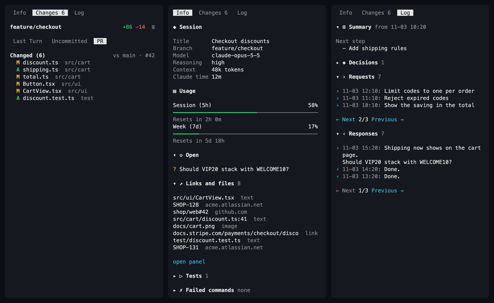
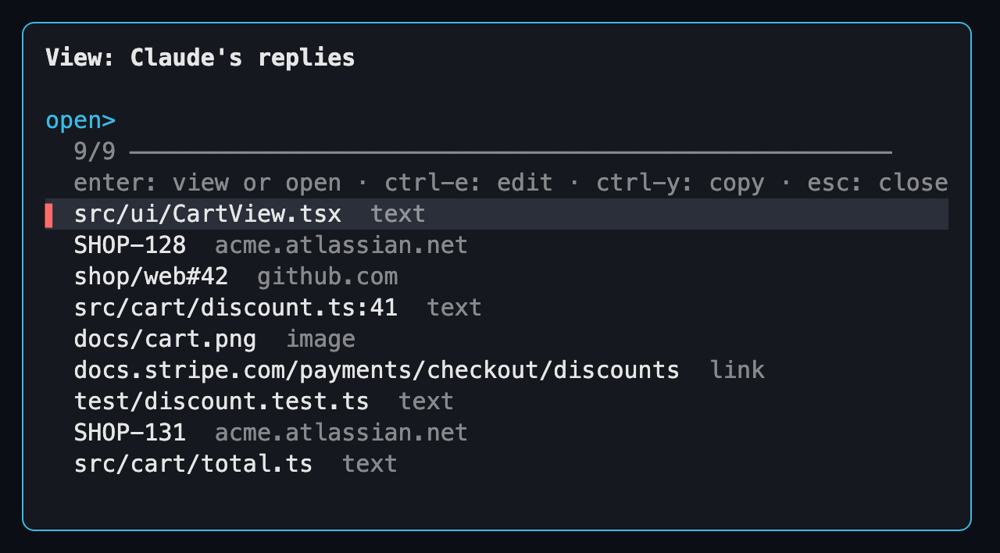
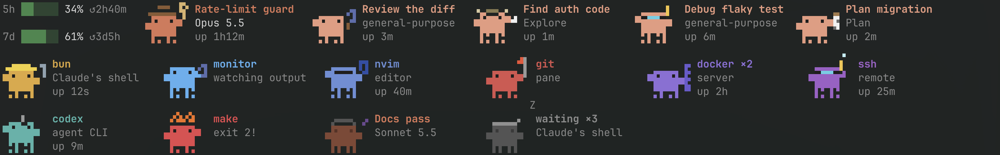

# Rex extensions and skills for Claude Code

Make the [Rex](https://www.superlogical.com) terminal a better home for
[Claude Code](https://claude.com/claude-code) on macOS: see what each Claude
changed and what you decided with it, watch your agents as pixel crabs, get your
conversations back after a restart, and let Claude show you files.

| | Name | What you get | Runs as |
| --- | --- | --- | --- |
| Extension | [cc-sidecar](#cc-sidecar) | A side pane with what each Claude changed, by turn, uncommitted, branch or pull request, plus its activity, open questions and decisions; Rex View opens the files, images and links in Claude's replies | Pane beside Claude |
| Extension | [cc-crab-pond](#cc-crab-pond) | Claudes, subagents and background jobs as animated crabs | Strip along the tab's bottom |
| Extension | [cc-resume](#cc-resume) | Claude Code conversations resumed after the Rex server restarts | Background watcher |
| Skill | [rex-view](#rex-view) | Claude shows images, Markdown and source code in a floating pane | Plugin, version 0.5.0 |

**Contents:** [Extensions](#extensions) · [Skills](#skills) ·
[Requirements](#requirements) · [Install](#install) · [Update](#update) ·
[Repository layout](#repository-layout) · [Privacy](#privacy) ·
[Tests](#tests) · [License](#license)

## Extensions

Rex loads these from `init.lua`. Each one's README has the details.

### cc-sidecar

Answers "what did this Claude change, and what's still waiting on me?" A pane on
the right, 20% of the tab, opens and closes with Claude and replaces Claude
Code's own diff panel.



**Changes** lists changed files for the last turn, the uncommitted work, or the
branch or its open pull request, as a list or a tree; click one to read its diff in a floating pane.
**Info** lists the session's facts, usage limits, open questions, test runs and
failed commands, in sections you can fold. **Log** shows the last summary, then
your decisions, requests and Claude's responses, dated and newest first.
**Rex View**, on `Cmd+Ctrl+Alt+Shift+O`, lists the files, images and links in
Claude's last replies, to view, edit or open in the browser, with your own
patterns for Jira keys or PR numbers.



[Tabs, keys and limits →](cc-sidecar/README.md)

### cc-crab-pond

Shows everything running in a tab at a glance. A strip along the bottom 8% of
each Claude tab draws one animated crab per Claude, subagent, background job and
program in the tab's other panes. Colour shows the kind of program, the hat shows
its job, and a failed command is on fire. Shown here with room for three rows and
sample crabs:



It needs one setup step: [saving Claude Code's status line input](#extensions-1).
[How to read the crabs →](cc-crab-pond/README.md)

### cc-resume

Gets your Claude conversations back after a reboot, Rex update or crash. Rex
restores sessions, tabs and splits but not the programs in them, so cc-resume
types `claude --resume <session>` into each pane that ran Claude. It has nothing
on screen. [How it works and what it can't restore →](cc-resume/README.md)

## Skills

Claude Code plugins, installed through this repository's marketplace. Claude
uses them when you ask; they need nothing in `init.lua`.

### rex-view

Ask Claude to show a file, in your own words: "show me that screenshot" or "open
the README in a pane". Images, Markdown and source code open in a floating pane
over Claude's tab, and `q` closes it. [Details →](plugins/rex-view/README.md)

## Requirements

| Needed for | What |
| --- | --- |
| Everything | macOS with [Rex](https://www.superlogical.com) and [Claude Code](https://claude.com/claude-code) |
| cc-crab-pond | A terminal font with Unicode 16 octant characters (Rex draws them itself), and `jq` for the status line (`brew install jq`) |
| cc-sidecar and rex-view colours, optional | [`bat`](https://github.com/sharkdp/bat) (`brew install bat`) |
| cc-sidecar's highlighted diffs, optional | [`delta`](https://github.com/dandavison/delta) (`brew install git-delta`) |
| cc-sidecar's Usage section, optional | The status line step in [Install](#install), with `jq` |
| cc-sidecar's Rex View list, optional | [`fzf`](https://github.com/junegunn/fzf) (`brew install fzf`), and `jq` for its settings |
| cc-sidecar's PR scope, optional | [`gh`](https://cli.github.com), signed in (`brew install gh`, `gh auth login`) |
| rex-view formatted Markdown, optional | [`glow`](https://github.com/charmbracelet/glow) (`brew install glow`) |

## Install

### Extensions

1. Clone the repository anywhere and link it into Rex's config folder:

   ```sh
   git clone https://github.com/evgeny-golubev/rex-extensions.git ~/Sites/utils/rex
   ln -s ~/Sites/utils/rex ~/.config/rex/extensions
   ```

2. Add the ones you want to `~/.config/rex/init.lua`:

   ```lua
   require("extensions.cc-resume")
   require("extensions.cc-sidecar")
   require("extensions.cc-crab-pond")
   ```

3. Load them:

   ```sh
   rex config reload
   ```

4. For cc-sidecar, turn off Claude Code's own diff panel by setting
   `"diffSidebarOpen": false` in `~/.claude.json`.

5. For cc-crab-pond and cc-sidecar's Usage section, have Claude Code's status
   line command save its input, which gives the crabs their names, models,
   outfits and subagents, and the sidecar your usage limits. Add these lines
   after your status line script reads stdin into `$input`:

   ```bash
   sid=$(echo "$input" | jq -r '.session_id // empty')
   [ -n "$sid" ] && mkdir -p ~/.claude/state/statusline && printf '%s' "$input" > ~/.claude/state/statusline/"$sid".json
   ```

   No status line yet? See
   [cc-crab-pond's setup](cc-crab-pond/README.md#claude-code-status-line) for a
   complete script and the `settings.json` entry.

### Skills

```sh
claude plugin marketplace add evgeny-golubev/rex-extensions
claude plugin install rex-view@rex-extensions
```

Then restart Claude Code, or run `/reload-plugins` in it.

## Update

Extensions: pull, then restart the watchers.

```sh
git -C ~/.config/rex/extensions pull
pkill -f 'extensions/.*/watcher\.lua'; rex config reload
```

cc-pane is now cc-sidecar. If your `init.lua` has `require("extensions.cc-pane")`,
change it to `require("extensions.cc-sidecar")` before you reload, and stop the old
watcher: the command above matches it too. Open `Changes:` panes are replaced by
new ones.

Skills:

```sh
claude plugin marketplace update rex-extensions
claude plugin update rex-view@rex-extensions
```

## Repository layout

```text
.claude-plugin/marketplace.json   the plugin marketplace
cc-resume/                        extension
cc-sidecar/                       extension
cc-crab-pond/                     extension
plugins/rex-view/                 skill, as a plugin
docs/                             pictures
```

## Privacy

Everything reads Claude Code's own files and the process list on your machine.
Nothing is sent anywhere and no AI is involved.

## Tests

```sh
rex do ~/.config/rex/extensions/cc-resume/test.lua
rex do ~/.config/rex/extensions/cc-sidecar/test.lua
rex do ~/.config/rex/extensions/cc-crab-pond/test.lua
rex do ~/.config/rex/extensions/plugins/rex-view/test.lua
```

The tests mock Rex and don't touch live sessions.

## License

MIT. The crab art is redrawn after
[crab-band](https://github.com/MaxHarfen/crab-band) (MIT); see
[LICENSE](LICENSE).
