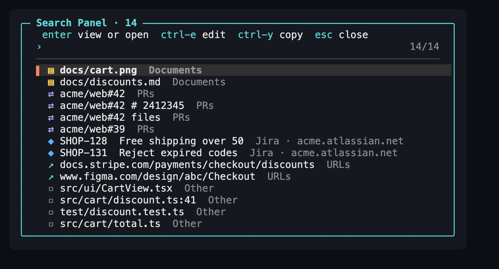
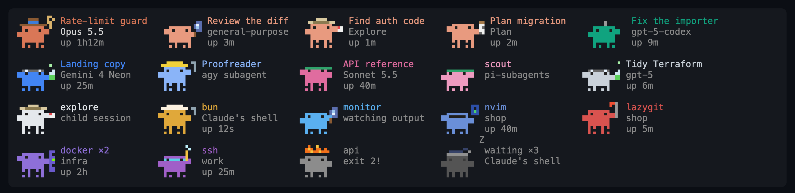
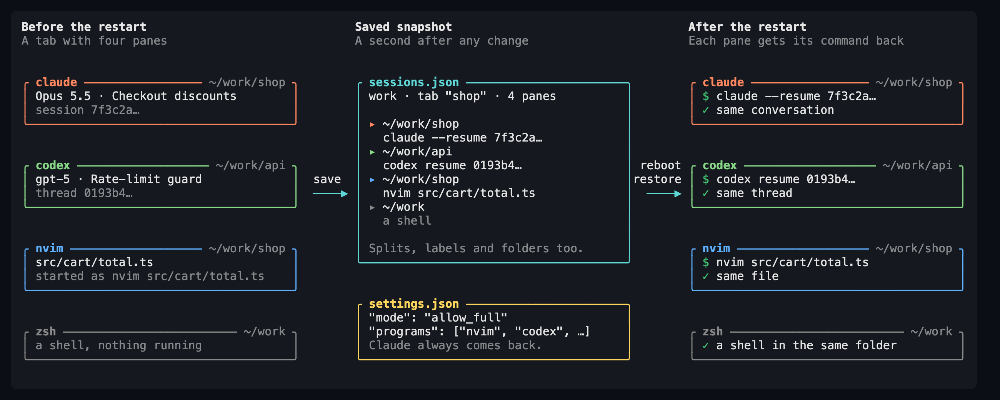

# Rex extensions and agent skills

Tools that make the [Rex](https://www.superlogical.com) terminal a better home
for coding agents on macOS. They work with
[Claude Code](https://claude.com/claude-code), and the extensions work with
[Codex](https://github.com/openai/codex), the
Antigravity CLI (`agy`), [Pi](https://github.com/badlogic/pi-mono) and
[OpenCode](https://opencode.ai) too.

- **See what your agent did.** A side pane shows the files it changed, a live
  dashboard of its work, and every link and document it mentioned.
- **Keep your day in view.** Your Google Tasks or Apple Reminders sit in the
  same pane, and the agent can report work done for you to confirm.
- **Watch everything at once.** Every agent, subagent and program in a tab
  shows up as a pixel crab.
- **Lose nothing on a restart.** After a reboot, your conversations and
  programs come back in their panes.
- **Let the agent show you things.** Pictures, reports and code open in a
  floating pane.

| | Name | What you get | Runs as |
| --- | --- | --- | --- |
| Extension | [rex-sidecar](#rex-sidecar) | What the agent changed, a dashboard of its work, what its replies mention, and your tasks | A pane beside the agent |
| Extension | [rex-crab-pond](#rex-crab-pond) | Agents, subagents and programs as animated crabs | A strip along the tab's bottom |
| Extension | [rex-resume](#rex-resume) | Claude Code, Codex, agy, Pi and OpenCode conversations, and programs like nvim, back after a restart | A background watcher |
| Skill | [rex-view](#rex-view) | Claude shows pictures, Markdown and code in a floating pane | Plugin 0.5.1 |
| Skill | [rex-sidecar-task-list](#rex-sidecar-task-list) | Claude keeps your task list in step with the work you do together | Plugin 0.2.0 |

**Contents:** [Extensions](#extensions) · [Skills](#skills) ·
[Install](#install) · [Update](#update) · [Requirements](#requirements) ·
[Troubleshooting](#troubleshooting) · [Uninstall](#uninstall) ·
[Privacy](#privacy) · [Repository layout](#repository-layout) ·
[Tests](#tests) · [Changelog](CHANGELOG.md) · [License](#license)

## Extensions

Rex loads extensions from its `init.lua`. Each one has its own README with the
details.

### rex-sidecar

Answers two questions: what did the agent change, and what's still waiting on
you? The pane opens on the right of every Claude Code, Codex, agy, Pi or OpenCode pane and closes
when the agent exits.


| Tab | What it shows |
| --- | --- |
| **Info** | The model, context and limits, every permission check, subagents on a timeline, running shells, open questions, the last turn and a session log |
| **Changes** | The files changed in the last turn, the uncommitted work, or the branch or its pull request. Click one to read its diff |
| **Artifacts** | The documents, PRs, Jira issues and links the agent's replies mention. The **Search Panel** (`Cmd+Ctrl+Alt+Shift+O`) lists them all in a float |
| **Tasks** (Google Tasks) and **Reminders** | Your day's work, rated A, B and C, with estimates and a daily review. Hidden until you show them |



[Tabs, keys and setup →](rex-sidecar/README.md)

### rex-crab-pond

Shows everything running in a tab at a glance. A strip along the bottom of the
tab draws one crab for each agent, subagent, background job and program. The
colour shows what kind of program it is, the hat shows its job, and a failed
command sets it on fire.



For full agent details (outfits and status), see [Agent setup](#agent-setup).
[How to read the crabs →](rex-crab-pond/README.md)

### rex-resume

Rex brings back your sessions, tabs and splits after a restart, but not the
programs in them. rex-resume types them back in: `claude --resume` for Claude
Code, `codex resume` for Codex, `agy --conversation` for agy, `pi --session`
for Pi, `opencode --session` for OpenCode, and the original
command for programs like
nvim. It has nothing on screen.



[Settings and limits →](rex-resume/README.md)

## Skills

Skills are Claude Code plugins, installed from this repository. Claude uses
them when they fit what you ask. They need nothing in `init.lua`.

### rex-view

Ask Claude to show you a file: "show me that screenshot" or "open the README
in a pane". It opens in a floating pane over Claude's tab, and `q` closes it.

[Details →](plugins/rex-view/README.md)

### rex-sidecar-task-list

When you start work with Claude, it adds the work to your task list, or finds
the task already there. When the work is done, Claude reports it, and you
confirm with one key in the sidecar. It works with the Google Tasks and
Reminders tabs. To set it up, ask Claude "set up the sidecar Tasks tab".
[Details →](plugins/rex-sidecar-task-list/README.md)

## Install

### Extensions

1. Clone the repository into Rex's config folder:

   ```sh
   git clone https://github.com/evgeny-golubev/rex-extensions.git ~/.config/rex/extensions
   ```

   To keep the code somewhere else, clone it there and link the folder
   instead:

   ```sh
   git clone https://github.com/evgeny-golubev/rex-extensions.git ~/Sites/utils/rex
   ln -s ~/Sites/utils/rex ~/.config/rex/extensions
   ```

2. Add the extensions you want to `~/.config/rex/init.lua`:

   ```lua
   require("extensions.rex-resume")
   require("extensions.rex-sidecar")
   require("extensions.rex-crab-pond")
   ```

3. Load them:

   ```sh
   rex config reload
   ```

### Agent setup

All five agents work out of the box after steps 1–3. Follow the optional step
for the agent(s) you use to unlock extra fields (context %, usage limits,
effort outfits or exact session tracking):

| Agent | Optional setup | What it adds |
| --- | --- | --- |
| **Claude Code** | Set `"diffSidebarOpen": false` in `~/.claude.json` (for sidecar), and save status line JSON (`jq`). [Full setup →](agents/README.md#claude-code) | Hides Claude's duplicate diff panel; adds context %, 5h/7d limits, pond outfits and monitor descriptions |
| **Codex** | None | Works out of the box using macOS `sqlite3`. [Details →](agents/README.md#codex) |
| **Antigravity CLI (`agy`)** | Add `agy-statusline.sh` to `~/.gemini/antigravity-cli/settings.json` (`jq`). [Full setup →](agents/README.md#antigravity-cli-agy) | 5h/7d usage quota bars and permission mode; context % for non-Gemini models and effort for models without an effort suffix |
| **Pi** | Link `pi-rex-status.ts` into `~/.pi/agent/extensions/` and restart Pi. [Full setup →](agents/README.md#pi) | Exact session tracking (including `--session` / `/resume`), context % and thinking level |
| **OpenCode** | None | Works out of the box with OpenCode 2.x using macOS `sqlite3`. [Details →](agents/README.md#opencode) |

Quick commands for the three optional setups:

- **Claude Code:** Add these two lines to your status line script after reading
  stdin into `$input` (or copy the complete script in
  [agents/README.md](agents/README.md#claude-code)):

  ```bash
  sid=$(echo "$input" | jq -r '.session_id // empty')
  [ -n "$sid" ] && mkdir -p ~/.claude/state/statusline && printf '%s' "$input" > ~/.claude/state/statusline/"$sid".json
  ```

- **agy:** Add to `~/.gemini/antigravity-cli/settings.json` (replace `/Users/you`
  with your home path; needs `jq`), then restart `agy`:

  ```json
  "statusLine": { "type": "command", "command": "/Users/you/.config/rex/extensions/agents/agy-statusline.sh" }
  ```

- **Pi:** Link the bundled extension and restart `pi`:

  ```sh
  mkdir -p ~/.pi/agent/extensions
  ln -s ~/.config/rex/extensions/agents/pi-rex-status.ts ~/.pi/agent/extensions/rex-status.ts
  ```

### Skills

```sh
claude plugin marketplace add evgeny-golubev/rex-extensions
claude plugin install rex-view@rex-extensions
claude plugin install rex-sidecar-task-list@rex-extensions
```

Then restart Claude Code, or run `/reload-plugins` in it.

## Update

Extensions: pull, then restart the watchers.

```sh
git -C ~/.config/rex/extensions pull
pkill -f 'extensions/.*/watcher\.lua'; rex config reload
```

Skills:

```sh
claude plugin marketplace update rex-extensions
claude plugin update rex-view@rex-extensions
claude plugin update rex-sidecar-task-list@rex-extensions
```

### Coming from older versions

- **Renamed extensions.** cc-sidecar is now rex-sidecar, cc-crab-pond is now
  rex-crab-pond, and cc-resume is now rex-resume. Change the `require` lines
  in your `init.lua`, then run the update commands above. Your settings move
  with the folders. Key bindings to their actions need the new names, such as
  `rex_sidecar_view` for `cc_sidecar_view`.
- **The Tasks tab is now two tabs**, Google Tasks and Reminders. The first
  time the sidecar opens, your old tab's place and state move to the tab of
  the source you used. Since v1.2.0 the Google one is named **Tasks** again,
  and a v1.1.0 **Google Tasks** tab moves to it the same way.
- **The task skill is renamed.** Replace the old plugin:

  ```sh
  claude plugin uninstall sidecar-task-list@rex-extensions
  claude plugin marketplace update rex-extensions
  claude plugin install rex-sidecar-task-list@rex-extensions
  ```

## Requirements

The extensions need macOS and [Rex](https://www.superlogical.com). Install the
agent CLI you use; Claude Code is only required for Claude panes and the
Claude Code plugins.

### Agent compatibility

| Feature | Claude Code | Codex | Antigravity CLI (`agy`) | Pi | OpenCode |
| --- | --- | --- | --- | --- | --- |
| Sidecar: Changes, Info and Artifacts | Yes | Yes, with the limits below | Yes, from its conversation transcript | Yes, from its session file | Yes, from its database |
| Crab pond: agent panes | Yes | Yes | Yes, with subagents | Yes, with subagents | Yes, with subagents |
| Resume conversations | `claude --resume` | `codex resume` | `agy --conversation` | `pi --session` | `opencode --session` |
| rex-view and rex-sidecar-task-list plugins | Yes | Not packaged for this agent | Not packaged for this agent | Not packaged for this agent | Not packaged for this agent |

The Info fields depend on what each agent records. Codex has no GATE approval
history or per-pane background process list, and its OPEN box only shows
questions from the last reply. Pi and OpenCode have no GATE history either.
See the [adapter details and known
limits](agents/README.md) for session discovery and agent-specific behavior.

### Dependencies by feature

| For | You need |
| --- | --- |
| Claude panes and plugins | [Claude Code](https://claude.com/claude-code) |
| Codex panes | The [Codex](https://github.com/openai/codex) CLI. Its sessions are read with the `sqlite3` that comes with macOS |
| agy panes | The Antigravity CLI. Its conversation is found with the `lsof` that comes with macOS, and its title and subagents are read with `sqlite3` (read only) |
| Pi panes | The [Pi](https://github.com/badlogic/pi-mono) CLI; optional [Pi extension](agents/README.md#pi) for exact session tracking and context % |
| OpenCode panes | [OpenCode](https://opencode.ai) 2.x. Its sessions are read with the `sqlite3` that comes with macOS |
| rex-crab-pond graphics | Unicode 16 octant characters (Rex draws them itself) |
| Claude context and limits, and status line details in the pond | The [Claude status line setup](agents/README.md#claude-code), with `jq` (`brew install jq`) |
| agy usage quota, permission mode, and context and effort for models whose ID doesn't give them | The [bundled agy status line script](agents/README.md#antigravity-cli-agy), with `jq` |
| Diffs, Markdown, pictures and documents in a reader | [`leaf`](https://leaf.dipxsy.app) (`brew install deepanshumishraa/tap/leaf`); the sidecar offers to install it |
| Highlighted diffs without leaf | [`delta`](https://github.com/dandavison/delta) (`brew install git-delta`); without it, [`bat`](https://github.com/sharkdp/bat) colours them |
| Colours in rex-view | [`bat`](https://github.com/sharkdp/bat) (`brew install bat`) |
| Formatted Markdown in rex-view without leaf | [`glow`](https://github.com/charmbracelet/glow) (`brew install glow`) |
| The Search Panel | [`fzf`](https://github.com/junegunn/fzf) (`brew install fzf`), and `jq` |
| PR scope and PR titles | [`gh`](https://cli.github.com), signed in (`brew install gh`, `gh auth login`) |

Install the CLI for each agent you use. The remaining dependencies apply to
the named features; you can leave out tools for features you don't need.

## Troubleshooting

| Symptom | What to check |
| --- | --- |
| No sidecar or pond appears | Check the `require` lines in `~/.config/rex/init.lua`, run `rex config reload`, and start `claude`, `codex`, `agy`, `pi` or `opencode` in a pane. If you closed the sidecar, run **Show Sidecar Pane** from the palette. Check that auto-show is enabled if you want it to open automatically. |
| An update has no effect | Config reload does not replace an already running watcher. Run the watcher restart command under [Update](#update). |
| Claude context or limits are missing | Check that the status line writes `~/.claude/state/statusline/<session-id>.json` (under `$CLAUDE_CONFIG_DIR` if set), and that `jq` is installed. See the [complete Claude setup](agents/README.md#claude-code). |
| A Codex, agy, Pi or OpenCode pane has no conversation yet | Send the first prompt so the agent creates its conversation. For Pi, link the [Pi extension](agents/README.md#pi) so a session opened with `--session` or `/resume` is found too. For Codex panes in the same folder with identical thread names, rename one. See [session discovery](agents/README.md). |
| Tasks or Reminders is missing | Both tabs are hidden initially. Enable the tab in [Tab settings](rex-sidecar/README.md#tab-settings), then follow the [Google Tasks](rex-sidecar/README.md#google-tasks) or [Reminders](rex-sidecar/README.md#reminders) setup. |

For sidecar errors, inspect the last 50 log lines:

```sh
tail -n 50 ~/.config/rex/state/rex-sidecar.log
```

The pond's startup errors go to
`~/.config/rex/state/rex-crab-pond.log`. A missing log can mean the extension
has not been loaded yet. Errors inside a sidecar tab also appear in the pane.

## Uninstall

### Extensions

1. Remove the corresponding `require("extensions.rex-...")` lines from
   `~/.config/rex/init.lua`, along with any custom bindings to their actions.
2. Stop the watchers, then reload the config:

   ```sh
   pkill -f 'extensions/.*/watcher\.lua'; rex config reload
   ```

   This stops all three extension watchers. To remove just one extension,
   use its name in the pattern, for example
   `pkill -f 'rex-sidecar/watcher\.lua'`, then run `rex config reload`.
3. Close any remaining sidecar or pond panes manually.

Keep the clone and `~/.config/rex/extensions` link to preserve the extensions'
local `settings.json` files, task state and resume snapshots. Removing the
`require` lines disables the extensions without deleting that data. To enable
them again, add the lines back and reload the config.

If you added the bundled agy status line command, remove that `statusLine`
entry from agy's settings before moving or deleting the clone. For Claude,
remove only the status line snippet that saves the input if you no longer
need it. You can also revert `diffSidebarOpen` if you changed it during setup.
If you linked the Pi extension, remove the link with
`rm ~/.pi/agent/extensions/rex-status.ts`. OpenCode's copies for the sidecar
are in `~/.config/rex/state/opencode/` and can be deleted.

### Skills

```sh
claude plugin uninstall rex-view@rex-extensions
claude plugin uninstall rex-sidecar-task-list@rex-extensions
```

Restart Claude Code, or run `/reload-plugins`. This removes the plugins;
your Google Tasks and Apple Reminders remain with their providers.

## Privacy

Everything runs on your Mac and reads local files: Claude Code's, Codex's and agy's
own files, Pi's session files, OpenCode's and agy's databases (read only) and the list
of running programs. rex-resume, and rex-sidecar and
rex-crab-pond for Codex and OpenCode, also read the command lines of programs, and the
sidecar reads which files an agy process has open, to find its conversation.
No AI is
involved.

Nothing is sent anywhere, with two exceptions you choose: the Google Tasks tab
talks to Google's Tasks API, and the PR scope and titles ask GitHub through
`gh`. Reminders stay on your Mac, apart from Apple's own sync.

## Repository layout

```text
.claude-plugin/marketplace.json   the plugin marketplace
agents/                           Claude Code, Codex, agy, Pi and OpenCode adapters
rex-sidecar/                      extension
rex-crab-pond/                    extension
rex-resume/                       extension
plugins/rex-view/                 skill, as a plugin
plugins/rex-sidecar-task-list/    skills, as a plugin
docs/                             pictures
```

## Tests

```sh
rex do ~/.config/rex/extensions/agents/test.lua
rex do ~/.config/rex/extensions/rex-sidecar/test.lua
rex do ~/.config/rex/extensions/rex-crab-pond/test.lua
rex do ~/.config/rex/extensions/rex-resume/test.lua
rex do ~/.config/rex/extensions/plugins/rex-view/test.lua
```

The tests mock Rex and don't touch live sessions.

## License

MIT. The crab art is redrawn after
[crab-band](https://github.com/MaxHarfen/crab-band) (MIT); see
[LICENSE](LICENSE).
