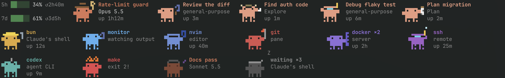

# CC Crab Pond for Rex

Opens a `Crabs` pane along the bottom 8% of every Rex tab that runs Claude
Code, and closes it when the last Claude in the tab exits. The pane shows what
runs in that tab as animated pixel crabs:



**Usage limits** sit on the far left: your 5-hour and weekly Claude limits, each
with the percentage used and the time to its reset (`↺`). The bar is green, turns
yellow at 70% and red at 90%.

**Every other crab is one thing running in the tab.** Read it in four parts:

| Part | Tells you | In the picture |
| --- | --- | --- |
| Body colour | What kind of thing it is | Blue is an editor, violet a server |
| Hat and prop | Its job, or for a Claude its model and effort | The wrench on `bun` means build or test |
| Movement | Its state | See the states below |
| Three lines of text | Its name, then its model, type or folder, then how long it's been running | `Rate-limit guard`, `Opus 5.5`, `up 1h12m` |

**The first crab is the tab's main Claude:** the focused Claude pane, or the last
one that was. It shows the session name, model and uptime, and its outfit shows
the model and effort:

| Model | Outfit |
| --- | --- |
| Fable | Wizard |
| Opus, effort max | Scientist |
| Opus, effort xhigh | Painter |
| Opus, effort high | Crown |
| Opus, effort medium or unknown | Cowboy |
| Opus, effort low | Ninja |
| Sonnet | Musician |
| Haiku | Gardener |

**Subagents** are lighter peach, titled with the task Claude gave them. The first
word of their type or task that names a job picks the outfit, matched at the
start of a word, so "reviewing" counts as "review". With no match they get a
random outfit, which stays the same for that task.

| Words such as | Outfit |
| --- | --- |
| search, find, explore, research | Explorer |
| plan, architect, spec | Clipboard |
| review, audit, check, verify | Magnifying glass |
| build, test, fix, implement | Hard hat and wrench |
| code, edit, refactor, rewrite | Sunglasses and a screen |
| git, commit, merge, PR | Flag |
| server, docker, API, deploy | Server rack |
| debug, trace, crash, bug | Diving mask |
| agent, automate, script | Robot antenna |
| analyse, benchmark, measure | Scientist |
| design, UI, CSS, layout | Painter |
| docs, README, write, summarise | Musician |
| clean, remove, upgrade, migrate | Gardener |
| quick, small, simple | Ninja |
| lead, coordinate, manage | Crown |
| generate, convert, transform | Wizard |

**Background shells, monitors and the programs in the tab's other panes** are
coloured by what the program does. Other Claudes in the tab appear under their
session names.

| Colour | Kind | Outfit | Programs |
| --- | --- | --- | --- |
| Sky blue | Claude's monitor | Magnifying glass | Claude watching a command's output |
| Blue | Editor | Sunglasses and a screen | nvim, vim, helix, emacs, nano, zed |
| Red | Git | Flag | git, gh, lazygit, tig, jj |
| Yellow | Build or test | Hard hat and wrench | go, cargo, make, npm, bun, node, python, pytest, xcodebuild |
| Violet | Server | Server rack | docker, kubectl, psql, redis, nginx, terraform |
| Purple | Remote | Diving mask | ssh, mosh, scp, rsync, tailscale |
| Teal | Agent CLI | Robot antenna | codex, gemini, aider, opencode, goose |
| Green | Anything else | None | |
| Gray | Shell | Nightcap | zsh, bash, fish |

**A crab's state shows in how it moves:**

| You see | It means |
| --- | --- |
| Bobbing, stepping and waving | Busy, with its uptime on the last line |
| Faded, eyes shut, with a drifting `Z` | Idle or waiting. A shell's second line says `zzz`, or `✓ zzz` if its last command succeeded |
| On fire, with `exit 2!` | The shell's last command failed, with that exit code |

**Crowded tabs stay readable.** Identical crabs merge into one with a count, such
as `docker ×2` or `waiting ×3`, showing the longest uptime, and waiting crabs come
last. A taller pane wraps the crabs onto more rows. When they still don't fit, a
plain gray crab with `+N` counts the rest.

Uptimes come from the process list for background shells and pane programs,
and from the start of the transcript for subagents. A subagent counts as running
while its transcript changed in the last 10 minutes. The full word lists are in
`pond.lua` (`outfit_words`).

Every crab is 14 x 12 pixels, drawn with octant characters (2 x 4 pixels a
cell, which Rex's renderer draws itself), so it takes 7 columns by 3 rows.
Busy crabs bob, step and wave; idle ones fade and blink. In a pane under 3
rows they get squatter and keep their hats. In a taller pane the crabs wrap
onto more rows, 4 pane rows each, at the bottom of the pane. When they still
don't fit, the last place shows a plain gray crab, `+N`, counting the rest.

Claude's background tasks come from the process list: the shells Claude
started and the programs under them. Only executable names are read, never
command arguments, which can hold secrets.

Session names, models, effort (which picks Claude's outfit) and the limits
come from Claude Code's status line input, which your status line command
saves to `~/.claude/state/statusline/<session>.json` (see
[Claude Code status line](#claude-code-status-line)). The subagent crabs
need it too: it names the session's transcript. Without it, Claude crabs are
plain and the limits and subagents are left out. Nothing is sent anywhere.

The crab art is redrawn at half size after
[crab-band](https://github.com/MaxHarfen/crab-band) (MIT), whose crab follows
Clawd, Claude Code's mascot by Anthropic.

## Install

Place this directory at `~/.config/rex/extensions/cc-crab-pond/` and add to your
Rex `init.lua`:

```lua
require("extensions.cc-crab-pond")
```

Then run `rex config reload`, and save Claude Code's status line input as
below. To load a changed `watcher.lua`, stop the running watcher first; the
crab panes reopen with the new `pond.lua`:

```sh
pkill -f 'cc-crab-pond/watcher\.lua'; rex config reload
```

### Claude Code status line

Claude Code passes each session's details (model, effort, session name, rate
limits, transcript path) to its status line command as JSON on stdin. The
pond reads them from a copy saved per session. It needs `jq`.

If you already have a status line script (`"statusLine"` in
`~/.claude/settings.json`), add this after the line that reads stdin into
`$input`:

```bash
# Read JSON input from stdin
input=$(cat)

# Save the input for the Rex cc-crab-pond extension
sid=$(echo "$input" | jq -r '.session_id // empty')
[ -n "$sid" ] && mkdir -p ~/.claude/state/statusline && printf '%s' "$input" > ~/.claude/state/statusline/"$sid".json
```

If you have none, save this as `~/.claude/statusline-command.sh`:

```bash
#!/bin/bash
# Read JSON input from stdin
input=$(cat)

# Save the input for the Rex cc-crab-pond extension
sid=$(echo "$input" | jq -r '.session_id // empty')
[ -n "$sid" ] && mkdir -p ~/.claude/state/statusline && printf '%s' "$input" > ~/.claude/state/statusline/"$sid".json
echo "$input" | jq -r '.model.display_name'
```

and point Claude Code at it in `~/.claude/settings.json`:

```json
{
  "statusLine": { "type": "command", "command": "bash ~/.claude/statusline-command.sh" }
}
```

Claude Code runs the command as the session updates, so the crabs pick up a
running session after its next reply. The saved files are small; remove
`~/.claude/state/statusline/` any time to clear them.

## Palette actions

| Action | What it does |
|---|---|
| Show Crabs Pane | Opens the pane in the focused tab, with or without a Claude in it |
| Disable / Enable Crabs Pane Auto-Show | Whether a pane opens by itself when Claude starts in a tab. On by default |

The choice is saved as `{"auto_show": false}` in `cc-crab-pond/settings.json`,
which git ignores. It applies to tabs where Claude starts from then on, so open
panes stay. The palette shows whichever of Disable and Enable applies. For a
key, bind `cc_crab_pond_show` or `cc_crab_pond_auto_show` with `rex.bind`.

## Behavior

- The crab pane keeps 8% of the tab: when another pane opens or closes
  there and Rex re-balances the tab, it's sized again.
- A crab pane you close stays closed until the tab has no Claude left, or you
  run Show Crabs Pane.
- When the watcher starts, it replaces leftover crab panes with new ones.
- cc-resume doesn't save crab panes; they come back with the resumed
  Claude.
- Watcher errors go to `~/.config/rex/state/cc-crab-pond.log`; the pane shows
  its own.

## Files

- `init.lua` starts the watcher and defines the palette actions.
- `settings.lua` reads and writes `settings.json`, and passes Show requests to
  the watcher through `show-request.json`.
- `watcher.lua` opens and closes the panes.
- `pond.lua` runs in each pane: gathers, lays out and draws.
- `sprites.lua` is the pixel art.
- `glyphs.lua` maps each 2 x 4 pixel pattern to its character, generated
  from Unicode 16's `UnicodeData.txt`.

## Tests

```sh
rex do ~/.config/rex/extensions/cc-crab-pond/test.lua
```

The tests mock Rex; they don't touch live sessions.
