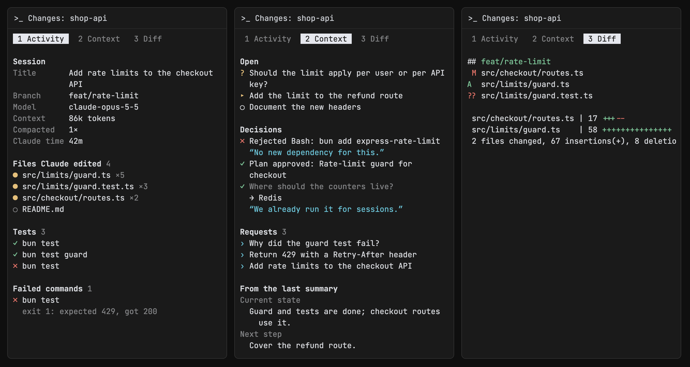

# CC Pane for Rex

Opens a `Changes: <folder>` pane to the right of every pane that runs Claude
Code, and closes it when Claude exits or its pane closes. It stands in for
Claude Code's own diff panel; turn that one off with `"diffSidebarOpen": false`
in `~/.claude.json`.



The pane has these tabs, redrawn every 2 seconds:

- **Activity**: the session's title, branch, model, context size,
  compactions and Claude's working time; the files Claude edited, marked ●
  while they have uncommitted changes (files outside the repository or
  folder are counted); test runs and whether they passed; and failed
  commands with their first error line.
- **Context**: what was asked, decided and left open in the Claude session
  beside the pane, newest first:
  - **Open**: a question or plan Claude is waiting on, questions at the end
    of Claude's last reply that you haven't answered yet, and unfinished
    tasks.
  - **Decisions**: your answers to Claude's questions (with your notes),
    plans you approved or rejected, and actions you rejected, with what you
    said.
  - **Requests**: your last 5 prompts, including slash commands and
    messages sent while Claude worked.
  - **From the last summary**: the "current state", "next step" and
    "pending" sections of the latest compaction summary.
- **Diff**, in a git repository: the uncommitted changes (`git status -sb`
  and `git diff --stat HEAD`).

The pane opens in the repository's root, or in Claude's folder outside one.

Press a tab's number, `Tab` or `←` `→` to switch. Scroll with the mouse
wheel, `j` / `k` or `↑` `↓`, `Space` / `b` or `Page Down` / `Page Up`, and
`g` for the top; the tab bar shows which lines are in view when they don't
all fit. Keys need the pane focused. The pane leaves the mouse to the
terminal, so dragging selects text as usual; the wheel reaches the pane as
arrow keys (the terminal's alternate scroll, mode 1007).

The Context and Activity tabs read Claude Code's own files and need no
Claude Code setting, hook or prompt: the Claude's session file
(`~/.claude/sessions/<pid>.json`, or under `$CLAUDE_CONFIG_DIR`) names its
transcript (`projects/<project>/<session>.jsonl`), which is read from where
the last read stopped. Nothing is sent anywhere, and no AI is involved, so
only what Claude Code records as structured data shows: a decision made in
plain conversation doesn't. Tests are recognised by their command: a test
runner (`pytest`, `jest`, …), a build tool's `test` command (`npm test`,
`go test`, `xcodebuild … test`, …) or a script file named test or spec. The
transcript format is Claude Code's own and undocumented, so an update to it
can empty these tabs.

Not a native Rex extension format: a config module launches a separate
event-driven `rex do` watcher, like cc-resume.

## Install

Place this directory at `~/.config/rex/extensions/cc-pane/` and add to
your Rex `init.lua`:

```lua
require("extensions.cc-pane")
```

Then run `rex config reload`. To load a changed `watcher.lua`, stop the running
watcher first:

```sh
pkill -f 'cc-pane/watcher\.lua'; rex config reload
```

## Behavior

- Claude is recognised by its program name, `claude`, in the foreground or as
  the parent of the foreground command. A pane started as `rex split -- claude`
  is found by a second look a second after its shell starts.
- The changes pane takes 20% of the width, and focus stays on the Claude
  pane.
- A changes pane you close stays closed until Claude starts again in that pane.
- When the watcher starts, it replaces leftover changes panes with new ones.
- cc-resume doesn't save changes panes; they come back with the resumed
  Claude.
- Errors go to `~/.config/rex/state/cc-pane.log`; the pane shows its
  own.

## Files

- `watcher.lua` opens and closes the panes.
- `panel.lua` runs in each pane: reads git and the transcript, and draws
  the tabs.

## Tests

```sh
rex do ~/.config/rex/extensions/cc-pane/test.lua
```

The tests mock Rex and use a made-up transcript; they don't touch live
sessions.
