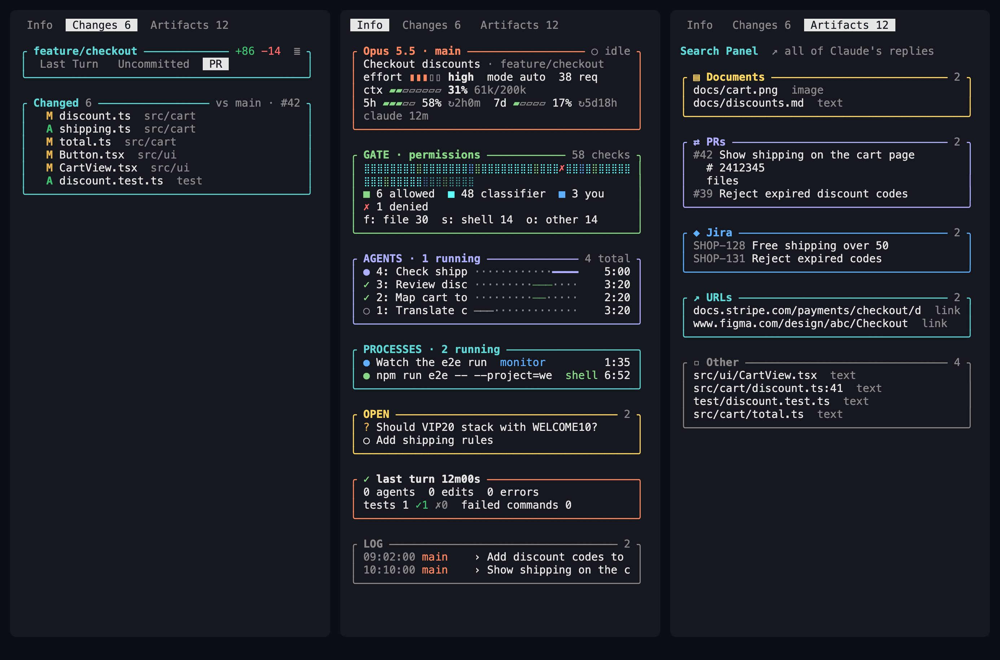
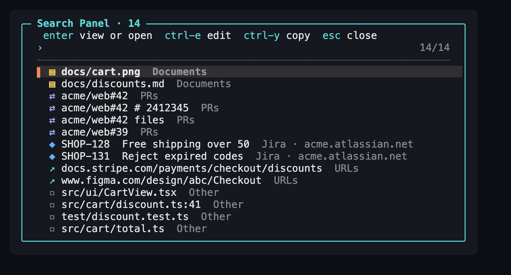

# CC Sidecar for Rex

Opens a `Sidecar: <folder>` pane to the right of every pane that runs Claude
Code, and closes it when Claude exits or its pane closes. It stands in for
Claude Code's own diff panel; turn that one off with `"diffSidebarOpen": false`
in `~/.claude.json`.



The pane has three tabs, a [Tasks](#tasks) tab you can show, and any that
[tab plugins](#tab-plugins) add, redrawn every 2 seconds, and every second while a
clock runs. Their look follows [Flightdeck](https://github.com/scasella/claude-flightdeck),
a Claude Code mod: each section is a box in its own colour, gauges are cells, and
an empty section takes no room. Below 36 columns, boxes become plain headings.

## Changes

The header box shows the branch, its added and removed lines, and `≣`, which
switches between a list and a folder tree. Inside it are up to three scopes:

| Scope | What it lists | Where it comes from |
| --- | --- | --- |
| **Last Turn** | Files Claude edited since your last prompt | The hunks in Claude's transcript |
| **Uncommitted** | Staged and Unstaged groups; the tree merges them | `git status`, `git diff` |
| **PR** | Everything since the branch left the base of its open GitHub pull request, including uncommitted work; it takes Branch's place | `gh pr view` for the base, then `git diff` against the merge base with `origin/<base>`, or else `<base>` |
| **Branch** | Everything since the branch left `main`, including uncommitted work | `git diff` against the merge base with `origin/HEAD`, or else `main` or `master` |

On the default branch itself, which is where `origin/HEAD` points, or else `main`
or `master`, there's no Branch scope. PR and Branch show what they compare with,
such as `vs develop · #12`. The pull request needs [gh](https://cli.github.com),
signed in. It's looked up when you open Changes, when the branch or repository
changes, and every 5 minutes while Changes stays open; without `gh`, or offline,
the scope is Branch.

Click a file or press `Enter` to read its diff in a floating pane; `q` closes it.
With [delta](https://github.com/dandavison/delta) installed, the code is
highlighted in the file's language, old and new sit side by side when the pane
has 120 columns or more, and delta's own git settings apply. Without it, [bat](https://github.com/sharkdp/bat) colours the added and removed lines.
The tab's count is the number of uncommitted files.

The tree lists folders before files at each level. Click a folder or select it
and press `Enter` to fold or unfold it; a folded folder shows how many files it
holds. The choice is saved in `settings.json`, for each repository.

Last Turn only knows Claude's Edit and Write tools, so files changed through
Bash (`sed`, a formatter) don't show up there. Outside a git repository it's the
only scope. The transcript format is Claude Code's own and undocumented, so an
update to it can empty this scope and the Info and Artifacts tabs.

## Info

Opens first. Every box folds; see [Folding](#folding).

| Box | What's in it |
| --- | --- |
| **Model · main** | Running or idle; the session's title and branch; reasoning effort, permission mode and how many requests Claude made; context against the model's window, and ⟲ with how often it was compacted; your 5-hour and 7-day limits with the time to each reset (↻), and Claude's working time |
| **ADVISOR** | The advisor tool's consults on a timeline from your first prompt, how long ago the last one was and how long it took. Shown only once Claude consults it |
| **GATE** | A dotted cell (`⣿`) for each latest permission check: green allowed by a rule or the mode, cyan by the auto-mode classifier, blue by you, red ✗ denied, dim made inside a subagent. Then the totals, and the checks by family: click `file`, `shell` or `other`, or press `f`, `s` or `o`, to list that family's last 5 checks |
| **AGENTS** | The latest 8 subagents as lanes on one time axis, newest first, each with its time. A running one has a pulsing lavender ● and a ticking clock. One that isn't marked finished but hasn't changed for 5 minutes, such as an idle team member, is shown idle with a grey ○. Click a lane for its type, context, steps, last 3 tool calls and the start of its answer |
| **PROCESSES** | Claude's background tasks that run right now, as Claude Code's own list shows them, newest first: a monitor by its description, a background shell by its command, with values that look like credentials masked. Each has a pulsing ● and its kind, green for a shell and blue for a monitor, and how long it has run. A task counts until a notification in the transcript ends it, a monitor's timeout passes, or no shell of Claude's that started with it is left; only executable names are read from `ps`. Hidden while none run |
| **OPEN** | Questions and plans waiting for your answer, questions at the end of Claude's last reply, and unfinished tasks |
| **Receipt** | The running turn, or the last one: how long, the agents it started, and its edits and errors. Then tests and failed commands: click either for the latest 8. A run counts as a test by its command: `pytest`, `npm test`, `go test`, a script named test or spec |
| **LOG** | Your prompts, agents starting and finishing, edits, failed commands, denied permission checks and advisor consults, each with its time. It fills the rows under the other boxes, or, when they fill the screen, a screen of its own below them |

The context window and the limits come from the status line step in the
[main README](../README.md#install); without them they're left out. Commands and
paths in GATE, the lanes, the receipt and the log have values that look like
credentials masked as `•••`: the value of a `TOKEN=`, `--password` or
`Authorization:`, a bearer token, and long key-like strings.

## Artifacts

What all of Claude's replies in this session mention, newest first. A reply is
Claude's final message after one of your prompts; what it wrote between tool
calls doesn't count. **Search Panel**, pinned at the top, opens the
[Search Panel](#search-panel). The tab's title shows how many rows there are, counting a PR once.

| Section | What's in it |
| --- | --- |
| **Documents** | Files that exist with `md`, `txt`, `pdf`, `html`, `csv`, `rtf`, `doc`, `docx`, `xlsx`, `pptx` or `svg`, and images |
| **PRs** | Links to a GitHub pull request (`/pull/12`) or a GitLab merge request (`/merge_requests/12`) |
| **Jira** | Links to a Jira issue (`/browse/KEY-12`) |
| **URLs** | Other `http` and `https` links |
| **Other** | Other files that exist, such as source code, with an optional `:line` |

[Link patterns](#link-patterns) turn text such as `SHOP-12` or `#12` into PRs
and Jira links. A category with nothing in it isn't shown, and each one folds. Each shows its
newest 10 rows; a last row says how many more there are and opens the Search
Panel.
Click a row to open it as Enter does in the Search Panel: a file or image in the
viewer, in a float, and a link in your browser. Something mentioned again is
listed once, where it was mentioned last. At most 1,000 rows are listed.

PRs are listed one row a PR, named by its number, in grey, and its title. A PR mentioned through more
than one link, such as its page, a comment and its files, has those links under
it: a comment as `# 123`, and other links by their last part, such as `files` or
`commit abc1234`. Click the PR to open it, or a link under it to open that.
Titles come from GitHub through [gh](https://cli.github.com), up to 4 at a time
while the tab is open, and each is looked up once; without `gh`, or for a GitLab
merge request, a PR shows its repository and number. The Search Panel lists each
link, such as `acme/shop#42 # 123`, without titles.

Jira issues show their key, in grey, and their title, as a reply wrote it next
to the key: a Markdown link's text, words in brackets after it (`SHOP-12 (Cart
rounding)`), after a colon or dash, or in the next table cell. A later mention
without one keeps an earlier title. Nothing is looked up, so an issue no reply
named shows its key and site.

git and gh run in the background, so the pane keeps taking keys and clicks while
they do. A scope you switch to shows "Loading…" until git is done, and a PR's
title appears when gh returns it.

Each reply is read once, as it comes in. All of them are read again when Claude
changes directory or you change the link patterns.

## Tasks

The day's work from Google Tasks or Apple Reminders, with a daily review. The
tab is hidden until you show it: press `,`, select **Tasks**, press `Space`,
then `Esc`. On first use it asks where your tasks are: `g` for Google Tasks
or `r` for Apple Reminders. `W` asks again later. The choice applies to every
sidecar pane.

It reads these conventions from the tasks themselves, so the task lists stay
usable in Google's and Apple's own apps:

| What | How it's written |
| --- | --- |
| Rating | A title that starts with `A. `, `B. ` or `C. `. A tasks come first |
| Estimate | A title that ends with `(30m)`, `(2h)` or `(1h30)` |
| Planned day | The due date |
| Steps | Subtasks, one level deep; Google Tasks only |

A task is recurring when its title, without rating and estimate, was completed
twice in the last 60 days, or once while a task with that title is open, or
when Apple Reminders says it repeats. It's shown in teal with `↻`.

| View | What's in it |
| --- | --- |
| **Now** | **Next**, the one next action: the first task due by today, or else the first A task, or its first open step. **Today**, with a progress bar and the time left. **Attention**, one item at a time |
| **Today** | What's due by today, then the next 7 days |
| **All** | Every open task by rating, with its steps |

Click a view's name or press `V` to switch. Attention lists, most important
first:

- a report from an agent that a task is done, to confirm with `y` or reject
  with `n` (see [Task actions](#task-actions));
- the daily review, once you pressed a key in the tab or prompted Claude today;
- an A task that is 3 days past due or was moved 3 times;
- a day with more than 6 hours of work, or A work of more than 6 hours. A task
  without an estimate counts as 72 minutes in the day and 2 hours in the A
  work, and a recurring one as 15 minutes;
- a task to split into steps: estimated above 2 hours, or 7 days past due
  without an estimate.

`v` starts the daily review. It shows each one-off task past due, one at a
time, to plan for today, give a new date, re-rate, split, estimate, finish or
drop; a dropped task is completed with the note "Dropped in review". Then, if A
work is more than a day, the A tasks to re-rate, and last today's list. The
header shows the streak of days in a row with a review.

| Key | What it does |
| --- | --- |
| `j` `k` | Select a task |
| `x`, or a click on `○` | Mark it done |
| `a` | Add a task, as `A. Title (20m) fri`: the last word can be a date, and without one the task is due today, or has no date in All |
| `A` `B` `C` | Rate it |
| `t` | Plan it for today |
| `d` | Give a new date: `today`, `tomorrow`, a weekday, `+3` or `2026-12-01`; empty clears it |
| `e` | Estimate it: `15m`, `1h`, `1h30`; empty clears it |
| `s` | Add steps, one per line; `Esc` finishes |
| `v` | Daily review; `-` drops a task, `]` skips one and `Esc` leaves |
| `Enter` | Select the task the Attention item is about |
| `y` `n` | Confirm or reject a report on the Attention item |
| `z` `]` | Hide the Attention item until tomorrow, or show the next |
| `r` | Fetch the tasks now |
| `W` | Choose where the tasks come from |
| `L` | Sign in, when the tab asks |
| `?` | List the keys |

The footer shows the keys that suit the selected task. A change shows at once,
dimmed until the provider has it, and is sent in the background, in order. The
tab fetches the tasks every 60 seconds, and reads its state file every 5
seconds, so a change from a task action shows at the next read.

The provider, the review streak, the hidden Attention items, the count of due
date changes and the reports wait in `tasks_state.json` beside
`settings.json`, which git ignores. Tasks themselves stay with Google or
Apple. With Google Tasks, the tab sends requests to Google's Tasks API; with
Apple Reminders, nothing leaves the Mac except through Apple's own sync.

### Google Tasks

The easiest way: ask Claude Code "set up the sidecar Tasks tab". With the
[sidecar-task-list](../plugins/sidecar-task-list/README.md) plugin installed,
Claude checks what is done already, then walks you through the rest one step at
a time and waits for you after each step.

No Google account, or no time? Use Apple Reminders: press `r` in the tab. It
needs no setup.

To set up Google Tasks yourself, once, in about 10 minutes:

1. Create a project at <https://console.cloud.google.com/projectcreate>. Any
   name works.
2. Open <https://console.cloud.google.com/apis/library/tasks.googleapis.com>,
   check that the new project is selected at the top, and click **Enable**.
3. Open <https://console.cloud.google.com/auth/overview> and click **Get
   started**. App name: anything without the word "Google", such as "Sidecar
   Tasks". Support and contact email: yours. Audience: **External**.
4. Open <https://console.cloud.google.com/auth/audience>. Leave the app in
   **Testing**. Under **Test users**, click **Add users**, add your Google
   address, and click **Save**.
5. Open <https://console.cloud.google.com/auth/clients>, click **Create
   client**, choose **Desktop app**, click **Create**, then **Download JSON**.
6. Store the file in the macOS Keychain, then delete it:

   ```sh
   ~/.config/rex/extensions/cc-sidecar/providers/google-tasks import-client ~/Downloads/client_secret_XXX.json
   rm ~/Downloads/client_secret_XXX.json
   ```

7. In the Tasks tab, press `g`, then `L`. Choose your account. On "Google
   hasn't verified this app", click **Advanced**, then **Continue**, and allow
   access. The tab loads your lists.

If something goes wrong:

| What you see | What to do |
| --- | --- |
| The app name is rejected | Leave "Google" out of the name, for example "G Task Client" |
| **Publish app** fails: "configuration is not complete in Branding" | Leave the app in Testing. It works; you sign in again every 7 days |
| "Error 403: access_denied", or "Sign-in failed: access denied" | Add your account as a test user (step 4), then press `L` again |
| You signed in with the wrong account | Sign out with `security delete-generic-password -s google-tasks-client -a refresh_token`, check that the right account is a test user, press `L` and choose it |
| "Sign-in needed" after a week | Expected while the app is in Testing: press `L` |
| "Google Tasks is not set up" | No client is stored yet: steps 5 and 6 |
| "This file is for a Web application client" | Create a client of type **Desktop app** |
| "HTTP 403 … has not been used in project" | Enable the Tasks API in the client's project (step 2) |

The client and the refresh token are kept in the Keychain under the service
`google-tasks-client`. `providers/google-tasks` runs from a terminal too; its
first lines list its commands.

### Apple Reminders

Press `r`. macOS asks once for access to Reminders; if the tab shows "Access
to Reminders needed", press `L` to ask again, or allow it in System Settings,
Privacy and Security, Reminders. Reminders has no order or subtasks that other
programs can read, so tasks come oldest first, and steps aren't available.

### Providers

A provider is a command in `providers/`, named in `task-providers.lua`. Its
contract is at the top of `tabs/tasks.lua`: `tasks`, `add`, `update` and
`login`, with JSON on standard output, exit code 3 when sign-in is needed, and
exit code 4 when the provider is not set up.

### Task actions

The extension adds three Rex actions, which reach the list through the provider
the tab uses, so an agent can keep it in step with its work:

| Action | What it does |
| --- | --- |
| `tasks_list` | The open tasks of every list, as JSON |
| `tasks_add title=... due=... [notes=...] [list=...] [parent=...]` | Adds a task and returns its ID. The title must start with a rating, unless it's a step under `parent`; `due` is `today`, `tomorrow` or `YYYY-MM-DD` |
| `tasks_report_done id=... [note=...]` | Reports a task done. The report waits in Attention for `y` or `n`; nothing is completed until then |

Run them as `rex do tasks_list`. The
[sidecar-task-list](../plugins/sidecar-task-list/README.md) skill teaches
Claude Code to use them.

## Search Panel

Press `Cmd+Ctrl+Alt+Shift+O`, run **Rex View: Search Panel** from the palette,
or click **Search Panel** on the Artifacts tab, to list what all of Claude's
replies mention, as on the [Artifacts](#artifacts) tab: by category, newest
first, with each category's icon and colour, and its name after each row. The
float is styled as the sidecar's boxes: a teal frame labelled with the count,
the keys at the top, an orange pointer and gold matches. The key reads the focused pane's
Claude, or else the first Claude in the tab. The list opens over the tab in a
float:



| Row | Enter | `Ctrl+E` |
| --- | --- | --- |
| A text file that exists: absolute, `~/`, or relative to Claude's directory, with an optional `:line` | Views it in the [rex-view](../plugins/rex-view/README.md) viewer, at the line | Edits it in your editor, in the float |
| An image: png, jpg, gif or webp | Views it | Views it |
| An `http` or `https` link | Opens it in your browser | Opens it |
| Text that a link pattern matches | Opens the link it makes | Opens it |

Type to filter. `Ctrl+Y` copies the path or link, and `Esc` closes the list.
Folders aren't listed. It needs [fzf](https://github.com/junegunn/fzf) for the
list; without it, rows are numbered and you type one. Each float replaces the
one before, including a rex-view float Claude opened.

### Editor

**Rex View: Set Editor** asks for the command `Ctrl+E` runs, such as `nvim`,
`code -w` or `subl -w`; the file is added at the end. Without one, it's
`$VISUAL`, then `$EDITOR`, then `vim`. It's saved as `"editor"` in
`settings.json`.

### Link patterns

A link pattern turns text in a reply into a link: a Jira key, or a pull request
number. Each one is locked to a directory, and applies to Claudes working in it
or below it; `/` is every project. **Rex View: Edit Link Patterns** lists them by
directory; Enter edits one, `Ctrl+A` adds one and `Ctrl+D` deletes one. A new
one starts with the directory of the tab's Claude. There are none until you add
them. They're saved in `settings.json`, as the directory, then a
[Lua pattern](https://www.lua.org/manual/5.1/manual.html#5.4.1) and the link
basis that the match is added to:

```json
{
  "link_patterns": {
    "/": {
      "%W(%u+%-%d+)": "https://acme.atlassian.net/browse/"
    },
    "/Users/you/Sites/acme": {
      "%W#(%d+)": "https://github.com/acme/web/pull/",
      "acme/web#(%d+)": "https://github.com/acme/web/pull/",
      "web!(%d+)": "https://gitlab.com/acme/web/-/merge_requests/"
    },
    "/Users/you/Sites/acme/mobile": {
      "%W(%u+%-%d+)": "https://acme-mobile.atlassian.net/browse/"
    }
  }
}
```

For a Claude in a directory, cc-sidecar takes that directory's patterns, then its
parent's, and so on up to `/`, and uses them all. When two set the same
pattern, the nearer one wins. With the example, `PROJ-12` opens
`https://acme-mobile.atlassian.net/browse/PROJ-12` under `acme/mobile`, and
`https://acme.atlassian.net/browse/PROJ-12` everywhere else. `acme/web#45` and
`#45` open a pull request only under `acme`, and not in `acme-old`, since directories
match whole path parts.

A pattern with a capture adds only the capture, so `acme/web#45` opens
`https://github.com/acme/web/pull/45`. In Lua patterns `%` escapes, so a dash is
`%-`, `%d` is a digit and `%u` a capital letter. A basis must start with
`http://` or `https://`. A pattern that isn't valid matches nothing.

Rex's Lua doesn't match `%f` word boundaries, so start a pattern with `%W`, a
character that isn't a letter or digit, and capture what follows: `%W(TF%-%d+)`
matches `TF-12` but not the `TF-8` in `UTF-8`, and `%W#(%d+)` matches `#12` but
not `repo#12`. A reply is matched with a line break before and after it, so
`%W` matches at its start and end too. The `#` rule in the example is locked to
`acme`, where a bare `#12` means that repository's pull request.

## Where Info and Artifacts get their data

Both tabs read Claude Code's own files and need no Claude Code setting, hook or
prompt: Claude's session file (`~/.claude/sessions/<pid>.json`, or under
`$CLAUDE_CONFIG_DIR`) names its transcript
(`projects/<project>/<session>.jsonl`), which is read from where the last read
stopped. Subagents are read from the `subagents` folder beside it, the status
line's saved input from `state/statusline/<session>.json`, and Claude's live
shells from `ps`, by executable name only. PR titles come from `gh`; nothing
else is sent anywhere by these two tabs, and no AI is involved, so only what Claude Code records
as structured data shows: a decision made in plain conversation doesn't.

## Folding

Click a box's top line to fold or unfold it, or highlight it with `n` and `p`
and press `Enter`; a folded box is one line. The choice is saved as `{"folded": {"Gate": true}}` in
`settings.json`, and applies to all sidecar panes within a couple of seconds.

## Keys and mouse

Click a tab, a scope, `≣`, a file, a box's top line, a gate family, an agent
lane, tests or failed commands, an Artifacts row or Search Panel. Keys need
the pane focused:

| Key | What it does |
| --- | --- |
| `1` to `9`, `Tab`, `←` `→` | Switch tabs |
| `s` | Next scope on Changes |
| `f` `s` `o` | On Info, list the last file, shell or other permission checks |
| `t` | List or tree; the choice is saved in `settings.json` |
| `j` `k`, `↑` `↓` | Move the selection on Changes, through folders too in the tree; scroll on Info and Artifacts |
| `n` `p` | Highlight the next or previous section on Info and Artifacts |
| `Enter` | On Changes, open the selected file's diff, or the first file's, or fold the selected folder. On Info and Artifacts, fold the highlighted section |
| `Space` `b`, `Page Down` `Page Up` | Scroll a page |
| `g` | Back to the top |
| `,` | Open the [tab settings](#tab-settings) |

The [Tasks](#tasks) tab has keys of its own.

The wheel scrolls. The pane takes clicks and drags for itself, so a plain drag
doesn't select text in it.

Not a native Rex extension format: a config module launches a separate
event-driven `rex do` watcher, like rex-resume.

## Tab settings

`,` opens the tab settings in the pane: each tab after Info, which always
shows, with `✓` when it shows. `j` `k` select a tab, `Space` or a click
shows or hides it, `J` `K` move it, and `Esc` or `,` closes the list. The
choice is saved as `{"tabs": {"order": [...], "hidden": {"Artifacts": true}}}`
in `settings.json` and applies to all sidecar panes within a couple of
seconds. Tabs the order doesn't name, such as a new plugin's, follow it.
Tasks is hidden until you show it.

## Tab plugins

Changes, Artifacts and Tasks are tab plugins, in this folder's `tabs/`. Each `*.lua`
file there and then in `~/.config/rex/sidecar-tabs/` adds a tab, in file name
order, and the [tab settings](#tab-settings) order them. The pane reads them
when it starts. A file gets the panel module as its argument
(`local sidecar = ...`) and returns a table:

| Field | What it is |
| --- | --- |
| `name` | The tab's title, not one in use. Required |
| `view(cols)` | Returns `{ lines, actions, pinned, hits, sections, selected }`. Required. See below |
| `refresh()` | Runs as a background task when the pane starts, then every `interval` seconds while no key was pressed in the last second. A hidden tab doesn't refresh |
| `interval` | Seconds between refreshes, 60 by default |
| `hidden` | True to hide the tab until it's shown in the tab settings |
| `activate()` | Runs when the tab opens. It must not wait for a command |
| `badge()` | The count beside the tab's title, or nil |
| `key(k)` | Gets each key while the tab is open, before the pane: a character, `up`, `down`, `left`, `right`, `pageup`, `pagedown` or `escape`. Returns true when it took the key |
| `act(action)` | Runs for a click on a line or column with an action. Actions of kind `tab` and `fold` are the pane's |

In a view, `actions[line]` is what a click on the line passes to `act`; an
action with `ranges = { { from, to, action } }` acts by column. `pinned` lines
stay above the others, and `hits[n]` holds the column ranges of pinned line
`n`. `sections`, from `sidecar.section`, are the boxes that `n` `p` and
`Enter` fold. `selected`, a line, is scrolled into view after a key.

From the module, a plugin uses `sidecar.run(argv, limit)`, which runs a
command and returns `{ ok, code, stdout }`, or nil after `limit` seconds (5 by
default); `sidecar.spawn(name, fn)`, which runs `fn` as a background task
unless one named `name` runs; and `sidecar.box`, `sidecar.clip`,
`sidecar.width`, `sidecar.wrap` and `sidecar.colours` to draw. In a task,
`run` waits without stopping the pane; elsewhere it stops the pane for up to
5 seconds, so `view`, `key` and `act` never run commands themselves: they
draw what the last refresh found, and start commands with `spawn`. A task
must not call `run` inside `pcall`. Changes and Artifacts also use
`sidecar.panel`, the pane's state, and the other fields the module lists for
them.

A file that doesn't load gets a tab, named after the file, that shows the
error, and an error in `view` shows on its tab. An error in a task, `key` or
`act` becomes the pane's notice, pinned on a tab whose view has no pinned
lines. The other tabs keep working.

## Install

Place this directory at `~/.config/rex/extensions/cc-sidecar/` and add to
your Rex `init.lua`:

```lua
require("extensions.cc-sidecar")
```

Then run `rex config reload`. To load a changed `watcher.lua`, stop the running
watcher first:

```sh
pkill -f 'cc-sidecar/watcher\.lua'; rex config reload
```

## Palette actions

| Action | What it does |
|---|---|
| Show Sidecar Pane | Opens the pane beside the focused Claude, or another Claude in the tab that has none |
| Disable / Enable Sidecar Pane Auto-Show | Whether a pane opens by itself when Claude starts. On by default |
| Rex View: Search Panel | The [Search Panel](#search-panel); also `Cmd+Ctrl+Alt+Shift+O` |
| Rex View: Set Editor | The command that [edits files](#editor) |
| Rex View: Edit Link Patterns | Adds, edits and deletes [link patterns](#link-patterns) |
| Tasks: List Open Tasks, Add Task, Report Task Done | The [task actions](#task-actions) |

The choice is saved as `{"auto_show": false}` in `cc-sidecar/settings.json`,
which git ignores. It applies from the next Claude that starts, so open panes
stay. The palette shows whichever of Disable and Enable applies. For a key, bind
`cc_sidecar_show` or `cc_sidecar_auto_show` with `rex.bind`. The Rex View
actions are `cc_sidecar_view`, `cc_sidecar_view_editor` and
`cc_sidecar_view_patterns`.

## Behavior

- Claude is recognised by its program name, `claude`, in the foreground or as
  the parent of the foreground command. A pane started as `rex split -- claude`
  is found by a second look a second after its shell starts.
- The pane takes 30% of the width, and focus stays on the Claude pane.
- The pane follows Claude's directory: after `/cd`, the scopes and the pane's
  label switch to the new directory's repository within
  a couple of seconds. They cover the whole repository, not only the folder
  Claude is in.
- A pane you close stays closed until Claude starts again in that pane, or you
  run Show Sidecar Pane.
- When the watcher starts, it replaces leftover sidecar panes with new ones,
  including `Changes:` panes from before this extension was renamed.
- rex-resume doesn't save sidecar panes; they come back with the resumed Claude.
- Errors go to `~/.config/rex/state/cc-sidecar.log`; the pane shows its own.

## Files

- `init.lua` starts the watcher, defines the palette actions and binds Rex
  View's key.
- `task-actions.lua` defines the task actions; `task-providers.lua` names
  the task providers in `providers/` and reads and writes `tasks_state.json`.
- `claude.lua` finds a pane's Claude and its transcript.
- `settings.lua` reads and writes `settings.json`, and passes Show requests to
  the watcher through `show-request.json`.
- `watcher.lua` opens and closes the panes.
- `panel.lua` runs in each pane: reads git, `gh`, `ps` and the transcript in
  background tasks, so keys work while they run, and draws the tabs.
- `diff-view` draws one diff in the floating pane.
- `mentions.lua` finds the files, images and links in Claude's replies;
  `view-collect.lua` writes them as the Search Panel's list, and `view-picker`
  shows it.
- `view-settings` asks for the editor and edits the link patterns.
- `tabs/` holds the Changes, Artifacts and Tasks tabs.

## Tests

```sh
rex do ~/.config/rex/extensions/cc-sidecar/test.lua
```

The tests mock Rex and use a made-up transcript and made-up tasks; they don't
touch live sessions or run a task provider.