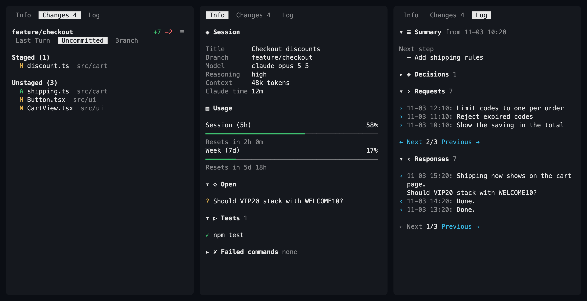

# CC Sidecar for Rex

Opens a `Sidecar: <folder>` pane to the right of every pane that runs Claude
Code, and closes it when Claude exits or its pane closes. It stands in for
Claude Code's own diff panel; turn that one off with `"diffSidebarOpen": false`
in `~/.claude.json`.



The pane has three tabs, redrawn every 2 seconds.

## Changes

The top row shows the branch, its added and removed lines, and `≣`, which
switches between a list and a folder tree. Below it are three scopes:

| Scope | What it lists | Where it comes from |
| --- | --- | --- |
| **Last Turn** | Files Claude edited since your last prompt | The hunks in Claude's transcript |
| **Uncommitted** | Staged and Unstaged groups; the tree merges them | `git status`, `git diff` |
| **Branch** | Everything since the branch left `main`, including uncommitted work | `git diff` against the merge base with `origin/HEAD`, or else `main` or `master` |

Click a file or press `Enter` to read its diff in a floating pane, with colours
if [bat](https://github.com/sharkdp/bat) is installed; `q` closes it. The tab's
count is the number of uncommitted files.

Last Turn only knows Claude's Edit and Write tools, so files changed through
Bash (`sed`, a formatter) don't show up there. Outside a git repository it's the
only scope. The transcript format is Claude Code's own and undocumented, so an
update to it can empty this scope and the Info and Log tabs.

## Info

Opens first. Open, Tests and Failed commands fold; see [Folding](#folding).

| Section | What's in it |
| --- | --- |
| **Session** | Title, branch, model, reasoning level, context size, how often it was compacted, and Claude's working time |
| **Usage** | Your 5-hour and 7-day limits and when they reset. Needs the status line step in the [main README](../README.md#install); hidden without it |
| **Open** | Questions and plans waiting for your answer, questions at the end of Claude's last reply, and unfinished tasks |
| **Tests** | The latest test runs and whether they passed. A run counts as a test by its command: `pytest`, `npm test`, `go test`, a script named test or spec |
| **Failed commands** | The latest failures, with their first error line |

## Log

What was said and decided. Summary has its local date and time in its title.
The other three sections start each entry with theirs, run newest first and show
3 entries a page. All four fold.

| Section | What's in it |
| --- | --- |
| **Summary** | The current state, next step and pending work from the latest compaction |
| **Decisions** | Your answers, with any notes; plans you approved or rejected; actions you rejected, with what you said |
| **Requests** | Your prompts, including slash commands and messages sent while Claude worked. Up to 6 rows each |
| **Responses** | Claude's final text in each turn, which changes while the turn runs. Up to 8 rows each, read from the first 2,000 characters |

A section with more than one page ends with `← Next 2/10 Previous →`. Previous
goes to earlier entries and Next to later ones. Click them, or highlight the
section and press `]` or `[`. The page isn't saved.

## Where Info and Log get their data

Both tabs read Claude Code's own files and need no Claude Code setting, hook or
prompt: Claude's session file (`~/.claude/sessions/<pid>.json`, or under
`$CLAUDE_CONFIG_DIR`) names its transcript
(`projects/<project>/<session>.jsonl`), which is read from where the last read
stopped. Nothing is sent anywhere, and no AI is involved, so only what Claude
Code records as structured data shows: a decision made in plain conversation
doesn't.

## Folding

Click a section's heading to fold or unfold it, or highlight it with `n` and `p`
and press `Enter`. The choice is saved as `{"folded": {"Tests": true}}` in
`settings.json`, and applies to all sidecar panes within a couple of seconds.

## Keys and mouse

Click a tab, a scope, `≣`, a file, a section heading or a pager's side. Keys need
the pane focused:

| Key | What it does |
| --- | --- |
| `1` `2` `3`, `Tab`, `←` `→` | Switch tabs |
| `s` | Next scope |
| `t` | List or tree; the choice is saved in `settings.json` |
| `j` `k`, `↑` `↓` | Move the selection on Changes, scroll on Info and Log |
| `n` `p` | Highlight the next or previous section on Info and Log |
| `[` `]` | Next and Previous page of the highlighted section on Log |
| `Enter` | On Changes, open the selected file's diff, or the first file's. On Info and Log, fold the highlighted section |
| `Space` `b`, `Page Down` `Page Up` | Scroll a page |
| `g` | Back to the top |

The wheel scrolls. The pane takes clicks and drags for itself, so a plain drag
doesn't select text in it.

Not a native Rex extension format: a config module launches a separate
event-driven `rex do` watcher, like cc-resume.

## Install

Place this directory at `~/.config/rex/extensions/cc-sidecar/` and add to
your Rex `init.lua`:

```lua
require("extensions.cc-sidecar")
```

Then run `rex config reload`. To load a changed `watcher.lua`, stop the running
watcher first:

```sh
pkill -f 'cc-sidecar/watcher\.lua'; rex config reload
```

## Palette actions

| Action | What it does |
|---|---|
| Show Sidecar Pane | Opens the pane beside the focused Claude, or another Claude in the tab that has none |
| Disable / Enable Sidecar Pane Auto-Show | Whether a pane opens by itself when Claude starts. On by default |

The choice is saved as `{"auto_show": false}` in `cc-sidecar/settings.json`,
which git ignores. It applies from the next Claude that starts, so open panes
stay. The palette shows whichever of Disable and Enable applies. For a key, bind
`cc_sidecar_show` or `cc_sidecar_auto_show` with `rex.bind`.

## Behavior

- Claude is recognised by its program name, `claude`, in the foreground or as
  the parent of the foreground command. A pane started as `rex split -- claude`
  is found by a second look a second after its shell starts.
- The pane takes 20% of the width, and focus stays on the Claude pane.
- The pane follows Claude's directory: after `/cd`, the scopes and the pane's
  label switch to the new directory's repository within
  a couple of seconds. They cover the whole repository, not only the folder
  Claude is in.
- A pane you close stays closed until Claude starts again in that pane, or you
  run Show Sidecar Pane.
- When the watcher starts, it replaces leftover sidecar panes with new ones,
  including `Changes:` panes from before this extension was renamed.
- cc-resume doesn't save sidecar panes; they come back with the resumed Claude.
- Errors go to `~/.config/rex/state/cc-sidecar.log`; the pane shows its own.

## Files

- `init.lua` starts the watcher and defines the palette actions.
- `settings.lua` reads and writes `settings.json`, and passes Show requests to
  the watcher through `show-request.json`.
- `watcher.lua` opens and closes the panes.
- `panel.lua` runs in each pane: reads git and the transcript, and draws
  the tabs.
- `diff-view` draws one diff in the floating pane.

## Tests

```sh
rex do ~/.config/rex/extensions/cc-sidecar/test.lua
```

The tests mock Rex and use a made-up transcript; they don't touch live
sessions.
