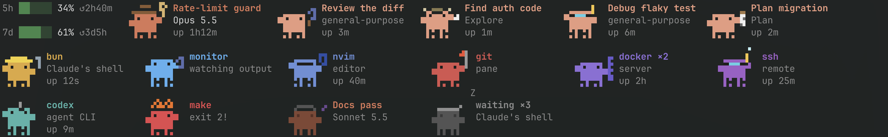

# Crab Pond for Rex

Opens a `Crabs` pane along the bottom 8% of every Rex tab that runs Claude
Code, and closes it when the last Claude in the tab exits. The pane shows what
runs in that tab as animated pixel crabs, left to right:



- **Usage limits**: Claude's 5-hour and weekly limits, one under the other,
  with the time to each reset.
- **The tab's main Claude**, with its session name, model and uptime. It's the
  focused Claude pane in the tab, or the last one that was.
- **A crab for everything else in the tab**: each Claude's subagents, named
  by the task Claude gave them; its background shells and monitors, named by
  the program they run; the tab's other Claudes, by their session names; and
  the program in each of the tab's other panes: editors, git, builds and
  tests, servers, ssh, agent CLIs, and sleeping shells. A shell whose last
  command failed is on fire.

Crabs with the same title and description are one crab with a count, such
as `waiting ×3` or `xcodebuild ×2`, and waiting crabs come last. Busy crabs show how long they've run (the
longest, for a group): background shells and pane programs from the process
list, subagents from the start of their transcripts. A subagent counts as
running while its transcript changed in the last 10 minutes.

| Crab | Outfit |
| --- | --- |
| Claude Fable | wizard |
| Claude Opus, effort max / xhigh / high / medium / low | scientist / painter / crown / cowboy / ninja |
| Claude Sonnet | musician |
| Claude Haiku | gardener |
| Subagent | by the first word of its type or task that names a job, else one picked by its task |
| Claude's monitor | magnifying glass, sky blue |
| Agent CLI | robot antenna, teal |
| Editor | sunglasses and a screen, blue |
| git, gh | flag, red |
| Build or test | hard hat and wrench, yellow |
| Docker, databases, servers | server rack, violet |
| ssh | diving mask, purple |
| Idle shell | nightcap, gray, asleep |

A subagent's job words, matched at the start of a word ("reviewing"):
search or explore → explorer, plan → clipboard, review or check → magnifying
glass, build or test → hard hat, code or refactor → editor, git or commit →
flag, server or deploy → server rack, debug or trace → diving mask,
automate or script → robot antenna, analyse or benchmark → scientist, design
or UI → painter, docs or write → musician, clean or migrate → gardener,
quick or small → ninja, lead or coordinate → crown, generate or convert →
wizard. The full lists are in `pond.lua` (`outfit_words`).

Every crab is 14 x 12 pixels, drawn with octant characters (2 x 4 pixels a
cell, which Rex's renderer draws itself), so it takes 7 columns by 3 rows.
Busy crabs bob, step and wave; idle ones fade and blink. In a pane under 3
rows they get squatter and keep their hats. In a taller pane the crabs wrap
onto more rows, 4 pane rows each, at the bottom of the pane. When they still
don't fit, the last place shows a plain gray crab, `+N`, counting the rest.

Claude's background tasks come from the process list: the shells Claude
started and the programs under them. Only executable names are read, never
command arguments, which can hold secrets.

Session names, models, effort (which picks Claude's outfit) and the limits
come from Claude Code's status line input, which your status line command
saves to `~/.claude/state/statusline/<session>.json` (see
[Claude Code status line](#claude-code-status-line)). The subagent crabs
need it too: it names the session's transcript. Without it, Claude crabs are
plain and the limits and subagents are left out. Nothing is sent anywhere.

The crab art is redrawn at half size after
[crab-band](https://github.com/MaxHarfen/crab-band) (MIT), whose crab follows
Clawd, Claude Code's mascot by Anthropic.

## Install

Place this directory at `~/.config/rex/extensions/crab-pond/` and add to your
Rex `init.lua`:

```lua
require("extensions.crab-pond")
```

Then run `rex config reload`, and save Claude Code's status line input as
below. To load a changed `watcher.lua`, stop the running watcher first; the
crab panes reopen with the new `pond.lua`:

```sh
pkill -f 'crab-pond/watcher\.lua'; rex config reload
```

### Claude Code status line

Claude Code passes each session's details (model, effort, session name, rate
limits, transcript path) to its status line command as JSON on stdin. The
pond reads them from a copy saved per session. It needs `jq`.

If you already have a status line script (`"statusLine"` in
`~/.claude/settings.json`), add this after the line that reads stdin into
`$input`:

```bash
# Read JSON input from stdin
input=$(cat)

# Save the input for the Rex crab-pond extension
sid=$(echo "$input" | jq -r '.session_id // empty')
[ -n "$sid" ] && mkdir -p ~/.claude/state/statusline && printf '%s' "$input" > ~/.claude/state/statusline/"$sid".json
```

If you have none, save this as `~/.claude/statusline-command.sh`:

```bash
#!/bin/bash
# Read JSON input from stdin
input=$(cat)

# Save the input for the Rex crab-pond extension
sid=$(echo "$input" | jq -r '.session_id // empty')
[ -n "$sid" ] && mkdir -p ~/.claude/state/statusline && printf '%s' "$input" > ~/.claude/state/statusline/"$sid".json
echo "$input" | jq -r '.model.display_name'
```

and point Claude Code at it in `~/.claude/settings.json`:

```json
{
  "statusLine": { "type": "command", "command": "bash ~/.claude/statusline-command.sh" }
}
```

Claude Code runs the command as the session updates, so the crabs pick up a
running session after its next reply. The saved files are small; remove
`~/.claude/state/statusline/` any time to clear them.

## Behavior

- The crab pane keeps 8% of the tab: when another pane opens or closes
  there and Rex re-balances the tab, it's sized again.
- A crab pane you close stays closed until the tab has no Claude left.
- When the watcher starts, it replaces leftover crab panes with new ones.
- claude-resume doesn't save crab panes; they come back with the resumed
  Claude.
- Watcher errors go to `~/.config/rex/state/crab-pond.log`; the pane shows
  its own.

## Files

- `watcher.lua` opens and closes the panes.
- `pond.lua` runs in each pane: gathers, lays out and draws.
- `sprites.lua` is the pixel art.
- `glyphs.lua` maps each 2 x 4 pixel pattern to its character, generated
  from Unicode 16's `UnicodeData.txt`.

## Tests

```sh
rex do ~/.config/rex/extensions/crab-pond/test.lua
```

The tests mock Rex; they don't touch live sessions.
