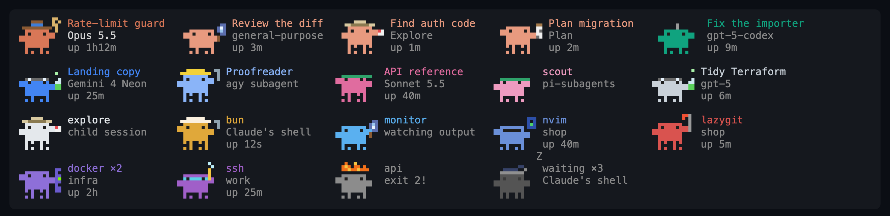

# Rex Crab Pond

**Everything running in your tab, as a pond of pixel crabs.** Glance down and
you know who's thinking, who's building, and who just caught fire.

- **One crab per thing:** each Claude, Codex, agy, Pi or OpenCode, subagent, background job and
  program in the tab's other panes.
- **Read it at a glance:** colour shows the kind of program, the hat shows its
  job, movement shows its state, and a failed command sets it on fire.
- **Dressed for the part:** a Claude's outfit shows its model and effort, from
  a Fable wizard to a Haiku gardener.
- **Out of the way:** a strip along the bottom of the tab that opens with your
  first agent and closes after the last.

**Try it:** add `require("extensions.rex-crab-pond")` to `~/.config/rex/init.lua`,
run `rex config reload`, and start a supported agent. For Claude model and
effort details, do the [status line step](#claude-code-status-line).
[Full install →](#install)



**On this page:** [Reading a crab](#reading-a-crab) · [Claude and other agents](#claude-and-other-agents) ·
[Subagents](#subagents) · [Programs](#programs-and-background-jobs) ·
[Install](#install) · [Palette actions](#palette-actions) · [Behavior](#behavior) ·
[Troubleshooting](#troubleshooting) · [Tests](#tests)

## Reading a crab

Each crab is one thing running in the tab. Read it in four parts:

| Part | Tells you | In the picture |
| --- | --- | --- |
| Body colour | What kind of thing it is | Blue is an editor, violet a server |
| Hat and prop | Its job, or for a Claude its model and effort | The wrench on `bun` means build or test |
| Movement | Its state | See below |
| Three lines of text | Its name, then its model, type or folder, then its uptime | `Rate-limit guard`, `Opus 5.5`, `up 1h12m` |

How it moves tells you its state:

| You see | It means |
| --- | --- |
| Bobbing, stepping and waving | Busy |
| Faded, eyes shut, a drifting `Z` | Idle or waiting. A shell says `zzz`, or `✓ zzz` if its last command worked |
| On fire, with `exit 2!` | The shell's last command failed, with that exit code |

A crowded tab stays readable. Identical crabs merge into one with a count,
such as `docker ×2` or `waiting ×3`, and show the longest uptime. Waiting crabs
go last. A taller pane wraps the crabs onto more rows. If they still don't
fit, a plain grey crab with `+N` counts the rest.

## Claude and other agents

The first crab is the tab's main agent: the focused agent pane, or the last
one that was. It shows the session's name, model and uptime. Other agents in
the tab get crabs of their own.

A Claude's outfit shows its model and effort:

| Model | Outfit |
| --- | --- |
| Fable | Wizard |
| Opus, effort max | Scientist |
| Opus, effort xhigh | Painter |
| Opus, effort high | Crown |
| Opus, effort medium or unknown | Cowboy |
| Opus, effort low | Ninja |
| Sonnet | Musician |
| Haiku | Gardener |

A Codex is green and named after its thread. Its outfit shows its reasoning
effort: a scientist for high or xhigh, a ninja for low or minimal, and a robot
otherwise.

An agy (Antigravity CLI) crab is Google blue. With agy's status line script
set up, its outfit shows its effort as a Codex's does; without it, it's a
robot.

A Pi crab is pink, and its outfit shows its thinking level as a Codex's does.
Each pi-subagents run gets a light pink crab of its own.

An OpenCode crab is silver-grey, dressed by its model's variant (high, low)
as a Codex is. Its subagents, OpenCode's child sessions, get lighter crabs.

Agents are found by program name, in any case: `claude`, `Claude` and
`CLAUDE` all count. The details come from [`../agents/`](../agents/README.md).

## Subagents

A Claude subagent is a lighter peach crab, titled with the task Claude gave
it. It counts as running while its transcript changed in the last 10 minutes.
A Codex subagent is lighter green, and counts as running while its thread
changed in the last 5 minutes.

The outfit comes from the first word of the subagent's type or task that names
a job. Words match at their start, so "reviewing" counts as "review". With no
match, the subagent gets a random outfit that stays the same for that task.

| Words such as | Outfit |
| --- | --- |
| search, find, explore, research | Explorer |
| plan, architect, spec | Clipboard |
| review, audit, check, verify | Magnifying glass |
| build, test, fix, implement | Hard hat and wrench |
| code, edit, refactor, rewrite | Sunglasses and a screen |
| git, commit, merge, PR | Flag |
| server, docker, API, deploy | Server rack |
| debug, trace, crash, bug | Diving mask |
| agent, automate, script | Robot antenna |
| analyse, benchmark, measure | Scientist |
| design, UI, CSS, layout | Painter |
| docs, README, write, summarise | Musician |
| clean, remove, upgrade, migrate | Gardener |
| quick, small, simple | Ninja |
| lead, coordinate, manage | Crown |
| generate, convert, transform | Wizard |

The full word lists are in `pond.lua` (`outfit_words`).

## Programs and background jobs

Claude's background shells and monitors, and the programs in the tab's other
panes, are coloured by what the program does:

| Colour | Kind | Outfit | Programs |
| --- | --- | --- | --- |
| Sky blue | Claude's monitor | Magnifying glass | Named by the description Claude gave it. Without the status line step, only a running `tail` is recognised, shown as `monitor` |
| Blue | Editor | Sunglasses and a screen | nvim, vim, helix, emacs, nano, zed |
| Red | Git | Flag | git, gh, lazygit, tig, jj |
| Yellow | Build or test | Hard hat and wrench | go, cargo, make, npm, bun, node, python, pytest, xcodebuild |
| Violet | Server | Server rack | docker, kubectl, psql, redis, nginx, terraform |
| Purple | Remote | Diving mask | ssh, mosh, scp, rsync, tailscale |
| Teal | Agent CLI | Robot antenna | gemini, aider, goose, and codex, agy, pi or opencode when their session isn't found |
| Green | Anything else | None | |
| Grey | Shell | Nightcap | zsh, bash, fish |

A build crab's hard hat takes its program's brand colour: gopher blue for
`go`, Python blue for `python`, npm red for `npm`. Its body stays yellow. The
full list is in `pond.lua` (`program_accents`).

Codex runs its commands under its app-server, not its own process. So a Codex
has no background shell crabs. agy also has no background job or subagent
crabs, and Pi and OpenCode have no background job crabs; programs in separate
panes still appear. See [adapter limits](../agents/README.md).

## Where the data comes from

- **Background jobs and pane programs** come from the process list. Only
  program names are read, never their arguments, which can hold secrets.
  Their uptimes come from there too.
- **A Claude's session name, model and effort** come from Claude Code's status
  line input, saved by your status line command (see
  [Claude Code status line](#claude-code-status-line)). It also names the
  transcript. The adapter can also find the session and transcript through
  Claude's session file, so subagent discovery does not require a status line.
  Without the saved input, model and effort details may be missing.
- **Subagent uptimes** come from the start of their transcripts.

Nothing is sent anywhere.

## Install

Requires macOS, Rex and the CLI for the agent you use. Claude Code is optional
for Codex, agy, Pi or OpenCode panes. Follow the [repository install guide](../README.md#install),
keeping `agents/` beside this folder under `~/.config/rex/extensions/`, and add
this line to `~/.config/rex/init.lua`:

```lua
require("extensions.rex-crab-pond")
```

Run `rex config reload`. For Claude model and effort details, save its status
line input as below. For agy model, effort and usage data, configure the
[bundled agy status line script](../README.md#install). For Pi, link the
[Pi extension](../README.md#install). Codex and OpenCode details come from
their databases, with no setup.

To load a changed `watcher.lua`, stop the running watcher first. The crab panes
reopen with the new `pond.lua`:

```sh
pkill -f 'rex-crab-pond/watcher\.lua'; rex config reload
```

Coming from cc-crab-pond, its earlier name: change the `require` line, then run
`pkill -f 'cc-crab-pond/watcher\.lua'; rex config reload`. The palette actions
are now named `rex_crab_pond_show` and `rex_crab_pond_auto_show`.

### Claude Code status line

Claude Code passes each session's details (model, effort, session name,
transcript path) to its status line command as JSON. The pond reads a copy
saved for each session. It needs `jq` (`brew install jq`).

If you already have a status line script (`"statusLine"` in
`~/.claude/settings.json`), add the save lines after its existing input read.
Read stdin only once; the snippet below includes that read for context:

```bash
# Read JSON input from stdin
input=$(cat)

# Save the input for rex-crab-pond
sid=$(echo "$input" | jq -r '.session_id // empty')
[ -n "$sid" ] && mkdir -p ~/.claude/state/statusline && printf '%s' "$input" > ~/.claude/state/statusline/"$sid".json
```

If you have none, save this as `~/.claude/statusline-command.sh`:

```bash
#!/bin/bash
# Read JSON input from stdin
input=$(cat)

# Save the input for rex-crab-pond
sid=$(echo "$input" | jq -r '.session_id // empty')
[ -n "$sid" ] && mkdir -p ~/.claude/state/statusline && printf '%s' "$input" > ~/.claude/state/statusline/"$sid".json
echo "$input" | jq -r '.model.display_name'
```

Then point Claude Code at it in `~/.claude/settings.json`:

```json
{
  "statusLine": { "type": "command", "command": "bash ~/.claude/statusline-command.sh" }
}
```

Merge the `statusLine` entry into your existing settings; keep other keys.
If you use `$CLAUDE_CONFIG_DIR`, use that directory in place of `~/.claude`
for the settings, script and saved status line files.

Claude Code runs the command as the session updates, so a running session
shows up after its next reply. The saved files are small. Delete
`~/.claude/state/statusline/` any time to clear them.

## Palette actions

| Action | What it does |
| --- | --- |
| Show Crabs Pane | Opens the pane in the focused tab, with or without an agent in it |
| Disable / Enable Crabs Pane Auto-Show | Whether the pane opens by itself when an agent starts in a tab. On by default |

The palette shows whichever of Disable and Enable applies. The choice is saved
as `{"auto_show": false}` in `rex-crab-pond/settings.json`, which git ignores.
It applies to tabs where an agent starts from then on; open panes stay. To
bind a key, use `rex.bind` with `rex_crab_pond_show` or `rex_crab_pond_auto_show`.

## Behavior

- The crab pane keeps about 9% of the tab's height. That's enough on a large
  display for three rows of crabs and a blank row. When Rex re-balances the
  tab, the pane is sized again.
- Each crab is 14 × 12 pixels, drawn with octant characters (2 × 4 pixels per
  cell), so it takes 7 columns by 3 rows. Rex draws these characters itself.
  In a pane under 3 rows, crabs get squatter and keep their hats.
- A crab pane you close stays closed until the tab has no agent left, or you
  run Show Crabs Pane.
- When the watcher starts, it replaces leftover crab panes with new ones.
- rex-resume doesn't save crab panes. They come back with the resumed agent.
- Watcher errors go to `~/.config/rex/state/rex-crab-pond.log`. The pane shows
  its own errors.

The crab art is redrawn at half size after
[crab-band](https://github.com/MaxHarfen/crab-band) (MIT), whose crab follows
Clawd, Claude Code's mascot by Anthropic.

## Troubleshooting

| Symptom | What to check |
| --- | --- |
| No pond opens | Start a supported agent, or run **Show Crabs Pane** from the palette. Check auto-show if you want new agent tabs to open it automatically. |
| Claude has no model or effort outfit | Check `jq`, the status line setting and the saved session JSON. Wait for the next agent reply to refresh it. |
| A Codex crab has the wrong title | Give threads in the same folder distinct names; see [Codex discovery](../agents/README.md#codex). |
| A crab says `+N` | More crabs exist than fit in the pane. Make it taller to show more rows. |
| Updated art or watcher code does not appear | Run the watcher restart command under Install so the crab panes reopen. |

Inspect watcher errors with `tail -n 50 ~/.config/rex/state/rex-crab-pond.log`.
Pane errors appear in the pane itself. See [uninstall](../README.md#uninstall)
to disable the pond while preserving its settings.

## Files

| File | What it does |
| --- | --- |
| `init.lua` | Starts the watcher and defines the palette actions |
| `settings.lua` | Reads and writes `settings.json`, and passes Show requests to the watcher through `show-request.json` |
| `watcher.lua` | Opens and closes the panes |
| `pond.lua` | Runs in each pane: finds what runs, lays out and draws the crabs. Finds each agent's session through [`../agents/`](../agents/README.md) |
| `sprites.lua` | The pixel art |
| `glyphs.lua` | Maps each 2 × 4 pixel pattern to its character, generated from Unicode 16's `UnicodeData.txt` |

## Tests

```sh
rex do ~/.config/rex/extensions/rex-crab-pond/test.lua
```

The tests mock Rex. They don't touch live sessions.
