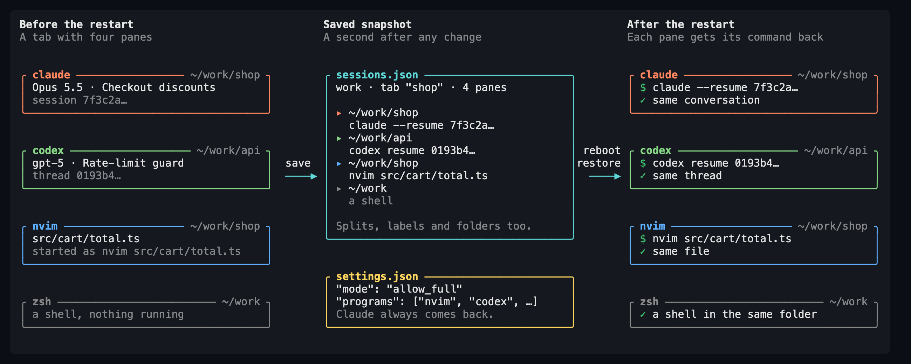

# Rex Resume

**Reboot without losing your place.** After a restart, a Rex update or a
crash, every pane comes back running what it ran before.



| Was running | Comes back as |
| --- | --- |
| Claude Code | `claude --resume <session>`: the same conversation, in the same folder |
| Codex | `codex resume <thread>`: the same conversation, in the thread's folder |
| nvim, less, htop, ssh and others | The same command, such as `nvim src/app.lua`, as your [settings](#settings) allow |
| A shell | A shell in the same folder |

There's nothing on screen and nothing to click.

**Try it:** add `require("extensions.rex-resume")` to `~/.config/rex/init.lua`
and run `rex config reload`. [Full install →](#install)

## How it works

Rex brings back sessions, tabs and splits by itself, but not the programs
that ran in them. rex-resume fills that gap:

1. **It saves.** A second after anything changes (a layout, a label, a
   folder or the program in a pane), it writes a snapshot of every session:
   tabs, splits, labels, folders and each pane's command.
2. **It restores, once.** When Rex starts again, it waits until Rex has
   finished bringing sessions back: the list of sessions must stay the same
   for 3 seconds, at most 20 seconds in all. Then:
   - a session Rex didn't bring back is created from the snapshot;
   - in a session Rex did bring back, it finds each pane again: the tab by
     its label or place, the pane by its folder or place. Once the pane's
     shell is ready, it types the saved command, with a `cd` first when the
     folder differs.

A pane that's already running a program is left alone. A snapshot is only
used after a real restart, and the used one is kept as `sessions.json.prev`.

## Settings

Settings are optional. They live in `settings.json` in this folder, which git
ignores. The file is read on every save, so an edit applies straight away.

```json
{
  "mode": "allow_full",
  "programs": ["nvim", "vim", "less", "htop"]
}
```

`mode` decides which programs come back, and how:

| `mode` | What comes back |
| --- | --- |
| `allow_full` (default) | Programs in `programs`, with their arguments: `nvim src/app.lua` |
| `allow_name` | Programs in `programs`, by name only: `nvim`. Their arguments are never read |
| `any_full` | Any program that isn't a shell, with its arguments. `programs` is ignored |

Without `programs`, the list is: nvim, vim, vi, nano, less, man, htop, btop,
top, watch, lazygit, tig, k9s, ssh and codex.

Claude Code always comes back, whatever the mode or the list.

### Arguments and privacy

Rex only tells the extension a program's name. The arguments come from `ps`,
and they're saved as plain text in the snapshot.

- In `allow_full` and `allow_name`, arguments are read only for programs on
  your list.
- In `any_full`, every program's arguments are saved. A token passed on a
  command line ends up in the snapshot too.
- `ps` drops quotes, so an argument with a space in it comes back as two.

## Claude Code and Codex

**Claude Code** is found through `~/.claude/sessions/<pid>.json`. Its original
flags, such as the model or the permission mode, aren't known, so it resumes
with the defaults.

**Codex** comes back with `codex resume <thread>`, in the thread's folder. The
thread is found as [agents/README.md](../agents/README.md#codex) describes.

Both take a moment before they can be saved. Claude writes its session file
a few seconds after it starts, and Codex only has a thread after your first
prompt. Until then, the save is tried again every 5 seconds, up to 6 times.
For Codex, its own command is saved in the meantime.

To have Codex panes come back as plain shells, leave `codex` out of
`programs`.

## Limits

- A program comes back as it was started, not as you left it. nvim reopens
  its file, but not its buffers or undo history.
- Quitting a resumed program leaves you in the shell it was typed into.
- rex-sidecar and rex-crab-pond panes aren't saved. They reopen by themselves
  when Claude resumes.

## Install

1. Put this folder at `~/.config/rex/extensions/rex-resume/`.
2. Add this line to `~/.config/rex/init.lua`:

   ```lua
   require("extensions.rex-resume")
   ```

3. Run `rex config reload`.

It isn't a native Rex extension: the config line starts a separate `rex do`
watcher that reacts to Rex's events. Every config load starts one, and a new
one quits when another is already running. So after changing `watcher.lua`,
stop the old one first:

```sh
pkill -f 'rex-resume/watcher\.lua'; rex config reload
```

### Upgrading from cc-resume

rex-resume used to be called cc-resume. Change the `require` line to the new
name, then run:

```sh
pkill -f 'cc-resume/watcher\.lua'; rex config reload
```

The snapshot stays where it was, so nothing is lost.

## Files

| File | What's in it |
| --- | --- |
| `~/.config/rex/state/sessions.json` | The snapshot |
| `~/.config/rex/state/sessions.json.prev` | The snapshot used at the last restore |
| `~/.config/rex/state/sessions.log` | Errors from starting the watcher |
| `settings.json`, in this folder | Your settings |

## Manual use

Run the watcher by hand, with a snapshot and settings of its own:

```sh
rex do --all ~/.config/rex/extensions/rex-resume/watcher.lua state=/tmp/x.json settings=/tmp/s.json
```

## Tests

```sh
rex do ~/.config/rex/extensions/rex-resume/test.lua
```

The tests fake Rex around a temporary folder. They don't touch live sessions
or the real snapshot.
