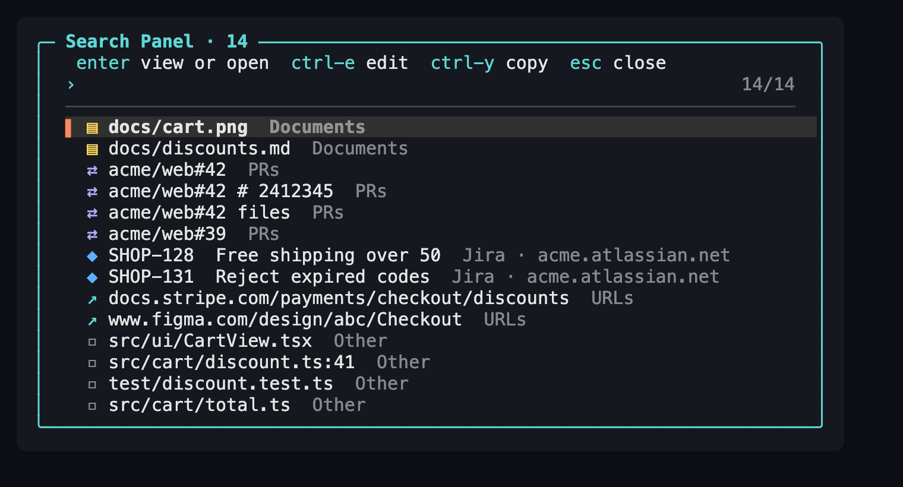
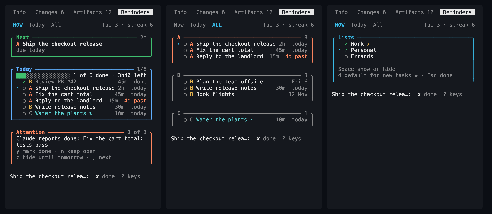

# Rex Sidecar

**Your coding agent's flight deck, docked right beside it.** It shows what
changed, what the agent is doing now, and what's still waiting on you. The
pane opens by itself.

- **Changes**: the files touched in the last turn, the uncommitted work, or
  the whole branch or pull request. Click one for a highlighted diff.
- **Info**: a live dashboard. Context and limits, every permission check,
  subagents on a timeline, running shells, open questions and a session log.
- **Artifacts**: every doc, PR, Jira issue and link the agent mentioned,
  titled and one click away. The Search Panel finds the rest.
- **Google Tasks** and **Reminders**: the day's work from Google Tasks or
  Apple Reminders. The agent can report a task done, and you confirm it.
- **Works with Claude Code and Codex.** A `Sidecar: <folder>` pane opens to the
  right of every agent pane and closes when the agent exits.

**Try it in 30 seconds:** add `require("extensions.rex-sidecar")` to
`~/.config/rex/init.lua`, run `rex config reload`, and start `claude` or `codex`
in a tab. [Full install →](#install)

**On this page:** [Changes](#changes) · [Info](#info) · [Artifacts](#artifacts) ·
[Search Panel](#search-panel) · [Task tabs](#task-tabs) ·
[Keys and mouse](#keys-and-mouse) · [Tab settings](#tab-settings) ·
[Tab plugins](#tab-plugins) · [Install](#install) · [Files](#files) · [Tests](#tests)


The sidecar replaces Claude Code's own diff panel. Turn that one off with
`"diffSidebarOpen": false` in `~/.claude.json`.

This page says "Claude". A Codex pane works the same way, except for what
[Codex doesn't record](../agents/README.md#codex).

The pane redraws every 2 seconds, and every second while a clock runs. Its
look follows [Flightdeck](https://github.com/scasella/claude-flightdeck), a
Claude Code mod. Each section is a box in its own colour, and gauges are
cells. An empty section takes no room. Below 36 columns, boxes become plain
headings.

## Changes

The top box shows the branch, its added and removed lines, and `≣`. Click `≣`
to switch between a list and a folder tree. Below the branch are up to three
scopes:

| Scope | What it lists | Where it comes from |
| --- | --- | --- |
| **Last Turn** | Files Claude edited since your last prompt | Claude's transcript |
| **Uncommitted** | Staged and unstaged files. The tree shows them together | `git status`, `git diff` |
| **PR** | Everything since the branch left the base of its open GitHub pull request, uncommitted work included. Replaces Branch | `gh pr view`, then `git diff` against `origin/<base>`, or `<base>` |
| **Branch** | Everything since the branch left `main`, uncommitted work included | `git diff` against `origin/HEAD`, or `main` or `master` |

- On the default branch itself there's no Branch scope.
- PR and Branch say what they compare with, such as `vs develop · #12`.
- The PR scope needs [gh](https://cli.github.com), signed in. Without it, or
  offline, you get Branch.
- The pull request is looked up when you open Changes, when the branch or
  repository changes, and every 5 minutes while Changes is open.
- The tab's count is the number of uncommitted files.

**Reading a diff.** Click a file, or select it and press `Enter`. The diff
opens in a floating pane, and `q` closes it. With
[delta](https://github.com/dandavison/delta), the code is highlighted, and old
and new sit side by side when the pane is 120 columns or wider. delta's own git
settings apply. Without delta, [bat](https://github.com/sharkdp/bat) colours
the added and removed lines.

**The tree.** Folders come before files. Click a folder, or select it and press
`Enter`, to fold it. A folded folder shows how many files it holds. Folds are
saved in `settings.json`, per repository.

**Limits.** Last Turn only sees Claude's Edit and Write tools, so a file
changed through Bash (`sed`, a formatter) doesn't show there. Outside a git
repository, Last Turn is the only scope. Claude Code's transcript format isn't
documented, so a Claude Code update can empty Last Turn, Info and Artifacts.

## Info

Info opens first. Every box folds; see [Folding](#folding).

| Box | What's in it |
| --- | --- |
| **Model · main** | Running or idle. The session's title and branch. Reasoning effort, permission mode and the number of requests. Context used against the model's window, and ⟲ with how often it was compacted. Your 5-hour and 7-day limits, with the time to each reset (↻). Claude's working time |
| **ADVISOR** | The advisor tool's consults on a timeline: how long ago the last one was, and how long it took. Shows only once Claude has consulted it |
| **GATE** | One dotted cell (`⣿`) per permission check. Green: allowed by a rule or the mode. Cyan: allowed by the auto-mode classifier. Blue: allowed by you. Red ✗: denied. Dim: made inside a subagent. Then the totals by family: click `file`, `shell` or `other`, or press `f`, `s` or `o`, to list that family's last 5 checks |
| **AGENTS** | The latest 8 subagents as lanes on one time axis, newest first. A running one has a pulsing ● and a ticking clock. One that hasn't changed for 5 minutes without finishing, such as an idle team member, shows a grey ○. Click a lane for its type, context, steps, last 3 tool calls and the start of its answer |
| **PROCESSES** | Claude's background tasks running right now, newest first, as Claude Code's own list shows them: a monitor by its description, a shell by its command. Green for a shell, blue for a monitor, with how long it has run. Hidden while none run |
| **OPEN** | Questions and plans waiting for your answer, questions at the end of Claude's last reply, and unfinished tasks |
| **Receipt** | The running turn, or the last one: how long it took, the agents it started, its edits and errors. Then tests and failed commands; click either to list the latest 8. A command counts as a test when it's `pytest`, `npm test`, `go test`, or a script named test or spec |
| **LOG** | Your prompts, agents starting and finishing, edits, failed commands, denied checks and advisor consults, each with its time. It fills the space below the other boxes, or a screen of its own when they fill the screen |

- Context and limits need the status line step in the
  [main README](../README.md#install). Without it they're left out.
- A background task stays listed until the transcript says it ended, a
  monitor's timeout passes, or no shell of Claude's that started with it is
  left. Only program names are read from `ps`, never arguments.
- Values that look like secrets are shown as `•••` in GATE, the lanes, the
  receipt, PROCESSES and the log: the value after `TOKEN=`, `--password` or
  `Authorization:`, bearer tokens, and long key-like strings.

## Artifacts

Everything Claude's replies in this session mention, newest first. A reply is
Claude's final message after one of your prompts; text written between tool
calls doesn't count. **Search Panel**, pinned at the top, opens the
[Search Panel](#search-panel).

| Section | What's in it |
| --- | --- |
| **Documents** | Files that exist with `md`, `txt`, `pdf`, `html`, `csv`, `rtf`, `doc`, `docx`, `xlsx`, `pptx` or `svg`, and images |
| **PRs** | Links to a GitHub pull request (`/pull/12`) or a GitLab merge request (`/merge_requests/12`) |
| **Jira** | Links to a Jira issue (`/browse/KEY-12`) |
| **URLs** | Other `http` and `https` links |
| **Other** | Other files that exist, such as source code, with an optional `:line` |

**Opening.** Click a row to open it, as `Enter` does in the Search Panel. A
file or image opens in the viewer in a float. A link opens in your browser.

**What's listed.**

- Empty sections are hidden, and each section folds.
- Each section shows its newest 10 rows. A last row says how many more there
  are and opens the Search Panel.
- Something mentioned twice is listed once, where it was mentioned last.
- At most 1,000 rows are kept. The tab's count counts a PR once.
- [Link patterns](#link-patterns) turn text such as `SHOP-12` or `#12` into
  Jira and PR links.

**PRs** get one row each: the number in grey, then the title. A PR mentioned
through several links, such as its page, a comment and its files, lists them
under it: a comment as `# 123`, other links by their last part, such as
`files` or `commit abc1234`. Titles come from GitHub through
[gh](https://cli.github.com), up to 4 at a time, once each. Without `gh`, and
for GitLab, a PR shows its repository and number.

**Jira issues** show their key in grey, then their title as a reply wrote it:
a Markdown link's text, words in brackets (`SHOP-12 (Cart rounding)`), text
after a colon or dash, or the next table cell. Nothing is looked up, so an
issue without a title in any reply shows its key and site.

Each reply is read once, as it arrives. All of them are read again when Claude
changes directory or you change the link patterns.

## Search Panel

Press `Cmd+Ctrl+Alt+Shift+O`, run **Rex View: Search Panel** from the palette,
or click **Search Panel** on Artifacts. A float lists everything Claude's
replies mention, as Artifacts does, with the category after each row. It reads
the focused pane's Claude, or the first Claude in the tab.



| Row | `Enter` | `Ctrl+E` |
| --- | --- | --- |
| A text file that exists: absolute, `~/`, or relative to Claude's folder, with an optional `:line` | Views it in the [rex-view](../plugins/rex-view/README.md) viewer, at the line | Edits it in your editor, in the float |
| An image: png, jpg, gif or webp | Views it | Views it |
| An `http` or `https` link | Opens it in your browser | Opens it |
| Text a link pattern matches | Opens the link it makes | Opens it |

Type to filter. `Ctrl+Y` copies the path or link, and `Esc` closes. Folders
aren't listed. The list needs [fzf](https://github.com/junegunn/fzf); without
it, rows are numbered and you type a number. Each float replaces the one
before, including a rex-view float Claude opened.

### Editor

**Rex View: Set Editor** asks for the command `Ctrl+E` runs, such as `nvim`,
`code -w` or `subl -w`. The file is added at the end. Without one, it uses
`$VISUAL`, then `$EDITOR`, then `vim`. It's saved as `"editor"` in
`settings.json`.

### Link patterns

A link pattern turns text in a reply into a link, such as a Jira key or a pull
request number. There are none until you add some.

**Rex View: Edit Link Patterns** lists them by folder. `Enter` edits one,
`Ctrl+A` adds one, and `Ctrl+D` deletes one. A new one starts with the folder
of the tab's Claude. They're saved in `settings.json`: the folder, then a
[Lua pattern](https://www.lua.org/manual/5.1/manual.html#5.4.1), then the link
the match is added to.

```json
{
  "link_patterns": {
    "/": {
      "%W(%u+%-%d+)": "https://acme.atlassian.net/browse/"
    },
    "/Users/you/Sites/acme": {
      "%W#(%d+)": "https://github.com/acme/web/pull/",
      "acme/web#(%d+)": "https://github.com/acme/web/pull/",
      "web!(%d+)": "https://gitlab.com/acme/web/-/merge_requests/"
    },
    "/Users/you/Sites/acme/mobile": {
      "%W(%u+%-%d+)": "https://acme-mobile.atlassian.net/browse/"
    }
  }
}
```

**Which patterns apply.** A pattern applies to Claudes working in its folder
or below it; `/` means every project. The sidecar uses the patterns of
Claude's folder, its parent, and so on up to `/`. If two folders set the same
pattern, the nearer one wins. Folders match whole path parts, so `acme` doesn't
cover `acme-old`.

With the example: `PROJ-12` opens `https://acme-mobile.atlassian.net/browse/PROJ-12`
under `acme/mobile`, and `https://acme.atlassian.net/browse/PROJ-12`
everywhere else. `acme/web#45` and `#45` open a pull request only under `acme`.

**Writing a pattern.**

- With a capture, only the capture is added: `acme/web#45` opens
  `https://github.com/acme/web/pull/45`.
- `%` escapes in Lua patterns: a dash is `%-`, a digit `%d`, a capital `%u`.
- The link must start with `http://` or `https://`.
- An invalid pattern matches nothing.
- Rex's Lua has no `%f` word boundaries. Start a pattern with `%W`, a
  character that isn't a letter or digit, and capture what follows.
  `%W(TF%-%d+)` matches `TF-12` but not the `TF-8` in `UTF-8`. `%W#(%d+)`
  matches `#12` but not `repo#12`. A reply gets a line break added at both
  ends, so `%W` also matches at its start and end.

## Task tabs

Two tabs show the day's work: **Google Tasks** and **Reminders** (Apple
Reminders). They work the same way, and each is hidden until you show it:
press `,`, select the tab, press `Space`, then `Esc`. You can show both.



The fastest setup: ask Claude Code **"set up the sidecar Tasks tab"**. With the
[rex-sidecar-task-list](../plugins/rex-sidecar-task-list/README.md) plugin
installed, Claude checks what's done and walks you through the rest, one step
at a time.

### How tasks are read

| What | How it's kept |
| --- | --- |
| Rating | A, B or C. A tasks come first. Google Tasks keeps it as a title prefix (`A. `); Reminders keeps it in its Priority field |
| Estimate | The end of the title: `(30m)`, `(2h)` or `(1h30)` |
| Planned day | The due date |
| Steps | Subtasks, one level deep. Google Tasks only |

Because of this, your lists stay usable in Google's and Apple's own apps.

A task counts as **recurring** when its title, without rating and estimate,
was completed twice in the last 60 days, or once while a task with that title
is open, or when Reminders says it repeats. It shows in teal with `↻`.

### Views

| View | What's in it |
| --- | --- |
| **Now** | **Next**: the one thing to do next, which is the first task due by today, or else the first A task, or its first open step. **Today**: today's tasks with a progress bar and the time left. **Attention**: one warning at a time |
| **Today** | What's due by today, then the next 7 days |
| **All** | Every open task, grouped by rating |

Click a view's name, or press `V`, to switch.

**Attention** lists, most important first:

- a report from an agent that a task is done, to confirm with `y` or reject
  with `n` (see [Task actions](#task-actions));
- the daily review, once you've pressed a key in the tab or prompted Claude
  today;
- an A task that's 3 days past due, or was moved 3 times;
- a day with more than 6 hours of work, or more than 6 hours of A work. A task
  without an estimate counts as 72 minutes of the day and 2 hours of A work; a
  recurring one counts as 15 minutes;
- in Google Tasks, a task to split into steps: estimated above 2 hours, or 7
  days past due with no estimate.

**The daily review** starts with `v`. It goes through each one-off task that's
past due, one at a time: plan it for today, give a new date, re-rate,
estimate, split (Google Tasks), finish, or drop it. A dropped task is completed
with the note "Dropped in review". Next, if A work is more than a day, it shows
the A tasks to re-rate. Last comes today's list. The header shows your streak
of days in a row with a review.

### Keys

| Key | What it does |
| --- | --- |
| `j` `k` | Select a task |
| `x`, or a click on `○` | Mark it done |
| `a` | Add a task, typed as `A. Title (20m) fri`. The last word can be a date. Without one, the task is due today, or has no date in All |
| `A` `B` `C` | Rate it |
| `t` | Plan it for today |
| `d` | Give it a new date: `today`, `tomorrow`, a weekday, `+3` or `2026-12-01`. Empty clears it |
| `e` | Estimate it: `15m`, `1h`, `1h30`. Empty clears it |
| `s` | Add steps, one per line; `Esc` finishes. Google Tasks only |
| `l` | Choose the lists shown and the list for new tasks. Reminders only |
| `m` | Move the task to another list. Reminders only |
| `v` | Daily review. In it, `-` drops a task, `]` skips one and `Esc` leaves |
| `V` | Switch view |
| `Enter` | Select the task the Attention item is about |
| `y` `n` | Confirm or reject a report |
| `z` `]` | Hide the Attention item until tomorrow, or show the next one |
| `r` | Fetch the tasks now |
| `L` | Sign in, when the tab asks |
| `?` | List the keys |

The footer shows the keys that suit the selected task.

### How changes are saved

- A change shows at once, dimmed until the provider has it. Changes are sent
  in the background, in order.
- The tab fetches the tasks every 60 seconds. It reads its state file every 5
  seconds, so a change from a task action shows quickly.
- Each tab keeps its review streak, hidden Attention items, due-date move
  counts and reports in a state file beside `settings.json`:
  `tasks_state.json` for Google Tasks, `reminders_state.json` for Reminders.
  git ignores both.
- The tasks themselves stay with Google or Apple. Google Tasks talks to
  Google's Tasks API. Reminders stays on your Mac, apart from Apple's own sync.

**Upgrading from the single Tasks tab.** Earlier versions had one Tasks tab
with a source picker. It now becomes the tab of the source it used, in the
same place in your tab order, with its streak and reports. There's no `W` key
any more: each tab is its own source.

### Google Tasks

The Google Tasks tab keeps the rating as a title prefix (`A. Fix the import`)
and has steps.

To set it up yourself, once, in about 10 minutes:

1. Create a project at <https://console.cloud.google.com/projectcreate>. Any
   name works.
2. Open <https://console.cloud.google.com/apis/library/tasks.googleapis.com>,
   check that the new project is selected at the top, and click **Enable**.
3. Open <https://console.cloud.google.com/auth/overview> and click **Get
   started**. App name: anything without the word "Google", such as "Sidecar
   Tasks". Support and contact email: yours. Audience: **External**.
4. Open <https://console.cloud.google.com/auth/audience>. Leave the app in
   **Testing**. Under **Test users**, click **Add users**, add your Google
   address, and click **Save**.
5. Open <https://console.cloud.google.com/auth/clients>, click **Create
   client**, choose **Desktop app**, click **Create**, then **Download JSON**.
6. Store the file in the macOS Keychain, then delete it:

   ```sh
   ~/.config/rex/extensions/rex-sidecar/providers/google-tasks import-client ~/Downloads/client_secret_XXX.json
   rm ~/Downloads/client_secret_XXX.json
   ```

7. In the Google Tasks tab, press `L` and choose your account. On "Google
   hasn't verified this app", click **Advanced**, then **Continue**, and allow
   access. The tab loads your lists.

If something goes wrong:

| What you see | What to do |
| --- | --- |
| The app name is rejected | Leave "Google" out of the name, for example "G Task Client" |
| **Publish app** fails: "configuration is not complete in Branding" | Leave the app in Testing. It works; you sign in again every 7 days |
| "Error 403: access_denied", or "Sign-in failed: access denied" | Add your account as a test user (step 4), then press `L` again |
| You signed in with the wrong account | Sign out with `security delete-generic-password -s google-tasks-client -a refresh_token`, check that the right account is a test user, press `L` and choose it |
| "Sign-in needed" after a week | Expected while the app is in Testing: press `L` |
| "Google Tasks is not set up" | No client is stored yet: steps 5 and 6 |
| "This file is for a Web application client" | Create a client of type **Desktop app** |
| "HTTP 403 … has not been used in project" | Enable the Tasks API in the client's project (step 2) |

The client and the sign-in are kept in the Keychain under the service
`google-tasks-client`. `providers/google-tasks` also runs from a terminal; its
first lines list its commands.

### Reminders

The Reminders tab needs no setup. macOS asks once for access to Reminders. If
the tab shows "Access to Reminders needed", press `L` to ask again, or allow it
in System Settings → Privacy & Security → Reminders.

**Ratings are priorities.** The tab shows A, B and C, and the `A` `B` `C` keys
set them, but they're saved in the reminder's Priority field: A is High, B is
Medium, C is Low. So Apple's apps show the priority, and titles stay clean.
Typing `A. Title` when adding a task sets High priority. A title that still
starts with `A. ` from before counts as that rating, and the prefix is removed
the next time you rate the task.

**Choosing lists (`l`).** A picker lists all your Reminders lists.

- `Space` shows or hides a list (✓ or ○). At least one list stays shown.
- `d` makes a list the default for new tasks, marked ★, and shows it if it
  was hidden. A hidden default isn't used. Without a default, a new task goes
  to the selected task's list, or the first shown list.
- `Esc` closes the picker.

**Moving a task (`m`).** Pick a list and press `Enter`. EventKit can't change
a saved reminder's list, so the tab copies the reminder into the new list and
deletes the original. The copy gets a new ID, and the tab's reports and
hidden warnings follow it. The title, notes, link, due date, priority, repeats
and alarms are copied. Attachments, tags and subtasks made in Apple's app
can't be read by other programs, so they're lost on a move.

**Not available:** steps, and the "split into steps" warnings. Reminders has no
order other programs can read, so tasks come oldest first.

### Task actions

Three Rex actions let an agent keep your lists in step with its work. Run them
as `rex do tasks_list`. The
[rex-sidecar-task-list](../plugins/rex-sidecar-task-list/README.md) skill
teaches Claude Code to use them.

| Action | What it does |
| --- | --- |
| `tasks_list [provider=...]` | The open tasks of every shown list. Each list has its `provider` (`google` or `apple`), each task its `rating` |
| `tasks_add title=... due=... [list=...] [provider=...] [notes=...] [parent=...]` | Adds a task and returns its ID. The title must start with a rating, unless it's a step under `parent`. `due` is `today`, `tomorrow` or `YYYY-MM-DD` |
| `tasks_report_done id=... [note=...] [provider=...]` | Reports a task done. The report waits in the tab's Attention for `y` or `n`; nothing is completed until then |

- Only the sources of shown tabs are asked. A source you don't use never runs.
- `tasks_add` picks the source from `provider=`, else from the source that has
  `list=`, else the only shown tab, else Google Tasks.
- In Reminders, the rating becomes the Priority, the task goes to the default
  list unless `list=` says otherwise, and `parent=` is refused: there are no
  steps.

### Providers

A provider is a command in `providers/`, named in `task-providers.lua`, which
also names each one's tab and state file. The contract is at the top of
`tasks-core.lua`:

- `tasks [--completed-since DATE]`, `add`, `update` and `login`;
- JSON on standard output;
- exit code 3 when sign-in is needed, and 4 when the provider isn't set up.

The Apple provider also takes `--priority A|B|C|none` on `add` and `update`,
returns each task's `priority`, and has `move LIST TASK NEWLIST`, which prints
the moved copy's ID.

## Folding

Click a box's top line to fold or unfold it. Or highlight it with `n` and `p`
and press `Enter`. A folded box is one line. Folds are saved in
`settings.json`, as `{"folded": {"Gate": true}}`, and every sidecar pane
picks them up within a couple of seconds.

## Keys and mouse

You can click a tab, a scope, `≣`, a file, a box's top line, a GATE family, an
agent lane, tests or failed commands, an Artifacts row, or Search Panel. Keys
need the pane focused.

| Key | What it does |
| --- | --- |
| `1` to `9`, `Tab`, `←` `→` | Switch tabs |
| `s` | Next scope on Changes |
| `f` `s` `o` | On Info, list the last file, shell or other permission checks |
| `t` | List or tree on Changes; saved in `settings.json` |
| `j` `k`, `↑` `↓` | Move the selection on Changes, folders included in the tree. Scroll on Info and Artifacts |
| `n` `p` | Highlight the next or previous box on Info and Artifacts |
| `Enter` | On Changes, open the selected file's diff, or fold the selected folder. On Info and Artifacts, fold the highlighted box |
| `Space` `b`, `Page Down` `Page Up` | Scroll a page |
| `g` | Back to the top |
| `,` | Open the [tab settings](#tab-settings) |

The task tabs have [keys of their own](#keys). A tab gets each key before
the pane does.

The wheel scrolls. The pane takes clicks and drags for itself, so a plain drag
doesn't select text in it.

## Tab settings

`,` lists every tab after Info, which always shows. A shown tab has `✓`.

- `j` `k` select a tab.
- `Space`, or a click, shows or hides it.
- `J` `K` move it.
- `Esc` or `,` closes the list.

The result is saved in `settings.json` as
`{"tabs": {"order": [...], "hidden": {"Artifacts": true}}}`, and every sidecar
pane picks it up within a couple of seconds. Tabs the order doesn't name, such
as a new plugin's, come after it. Google Tasks and Reminders are hidden until
you show them.

## Tab plugins

Changes, Artifacts, Google Tasks and Reminders are tab plugins in this folder's
`tabs/`. The two task tabs share their code in `tasks-core.lua`.

Each `*.lua` file in `tabs/`, then in `~/.config/rex/sidecar-tabs/`, adds a
tab, in file name order. The pane reads them when it starts. A file gets the
panel module as its argument (`local sidecar = ...`) and returns a table:

| Field | What it is |
| --- | --- |
| `name` | The tab's title, not one already in use. Required |
| `view(cols)` | Returns `{ lines, actions, pinned, hits, sections, selected }`. Required. See below |
| `refresh()` | Runs as a background task when the pane starts, then every `interval` seconds, unless a key was pressed in the last second. A hidden tab doesn't refresh |
| `interval` | Seconds between refreshes, 60 by default |
| `hidden` | True to hide the tab until it's shown in the tab settings |
| `activate()` | Runs when the tab opens. It must not wait for a command |
| `badge()` | The count beside the tab's title, or nil |
| `key(k)` | Gets each key while the tab is open, before the pane: a character, `up`, `down`, `left`, `right`, `pageup`, `pagedown` or `escape`. Returns true when it used the key |
| `act(action)` | Runs for a click on a line or column with an action. Actions of kind `tab` and `fold` belong to the pane |

**The view.**

- `actions[line]` is what a click on that line passes to `act`. An action
  with `ranges = { { from, to, action } }` acts by column.
- `pinned` lines stay above the others, and `hits[n]` holds the clickable
  column ranges of pinned line `n`.
- `sections`, made with `sidecar.section`, are the boxes `n`, `p` and `Enter`
  fold.
- `selected`, a line number, is scrolled into view after a key.

**Running commands.** `sidecar.run(argv, limit)` runs a command and returns
`{ ok, code, stdout }`, or nil after `limit` seconds (5 by default).
`sidecar.spawn(name, fn)` runs `fn` as a background task, unless a task named
`name` already runs. Inside a task, `run` waits without stopping the pane.
Anywhere else it stops the pane for up to 5 seconds. So `view`, `key` and
`act` never run commands themselves: they draw what the last refresh found,
and start commands with `spawn`. A task must not call `run` inside `pcall`.

**Drawing.** Use `sidecar.box`, `sidecar.clip`, `sidecar.width`,
`sidecar.wrap` and `sidecar.colours`. The built-in tabs also use
`sidecar.panel`, the pane's state, and other fields the module lists for them.

**Errors.** A file that doesn't load gets a tab, named after the file, showing
the error. An error in `view` shows on its tab. An error in a task, `key` or
`act` becomes the pane's notice. The other tabs keep working.

## Install

Place this folder at `~/.config/rex/extensions/rex-sidecar/` and add this to
your Rex `init.lua`:

```lua
require("extensions.rex-sidecar")
```

Then run `rex config reload`.

This isn't a native Rex extension format: a config module starts a separate,
event-driven `rex do` watcher. To load a changed `watcher.lua`, stop the
running watcher first:

```sh
pkill -f 'rex-sidecar/watcher\.lua'; rex config reload
```

## Palette actions

| Action | What it does |
| --- | --- |
| Show Sidecar Pane | Opens the pane beside the focused Claude, or another Claude in the tab that has none |
| Disable / Enable Sidecar Pane Auto-Show | Whether a pane opens by itself when Claude starts. On by default |
| Rex View: Search Panel | The [Search Panel](#search-panel); also `Cmd+Ctrl+Alt+Shift+O` |
| Rex View: Set Editor | The command that [edits files](#editor) |
| Rex View: Edit Link Patterns | Adds, edits and deletes [link patterns](#link-patterns) |
| Tasks: List Open Tasks, Add Task, Report Task Done | The [task actions](#task-actions) |

- Auto-show is saved as `{"auto_show": false}` in `settings.json`. It applies
  from the next Claude that starts; open panes stay. The palette shows
  whichever of Disable and Enable applies.
- To bind keys with `rex.bind`, the action names are `rex_sidecar_show`,
  `rex_sidecar_auto_show`, `rex_sidecar_view`, `rex_sidecar_view_editor` and
  `rex_sidecar_view_patterns`.

## Behavior

- Claude is recognised by its program name, `claude`, and Codex by `codex`, in
  any case, in the foreground or as the parent of the foreground command. A
  pane started as `rex split -- claude` is found by a second look a second
  after its shell starts.
- The pane takes 30% of the width. Focus stays on the Claude pane.
- The pane follows Claude's folder. After `/cd`, the scopes and the pane's
  label switch to the new folder's repository within a couple of seconds. They
  cover the whole repository, not only Claude's folder.
- A pane you close stays closed until Claude starts again in that pane, or you
  run Show Sidecar Pane.
- When the watcher starts, it replaces leftover sidecar panes with new ones,
  including `Changes:` panes from before this extension was renamed.
- rex-resume doesn't save sidecar panes. They come back with the resumed
  Claude.
- Errors go to `~/.config/rex/state/rex-sidecar.log`. The pane shows its own.

## Where Info and Artifacts get their data

Both tabs read Claude Code's own files. They need no Claude Code setting, hook
or prompt.

- Claude's session file (`~/.claude/sessions/<pid>.json`, or under
  `$CLAUDE_CONFIG_DIR`) names its transcript
  (`projects/<project>/<session>.jsonl`). The transcript is read from where the
  last read stopped.
- Subagents come from the `subagents` folder beside the transcript.
- Context and limits come from the status line's saved input,
  `state/statusline/<session>.json`.
- Claude's live shells come from `ps`, by program name only.
- PR titles come from `gh`.

Nothing else is sent anywhere, and no AI is involved. So only what Claude Code
records as data shows: a decision made in plain conversation doesn't.

For Codex, the session is its thread in `~/.codex/state_<n>.sqlite`, found as
[agents/README.md](../agents/README.md#codex) describes. The transcript is the
thread's rollout. Subagents are the threads it spawned, and usage limits come
from the rollout that changed last.

## Files

- `init.lua` starts the watcher, adds the palette actions and binds the Search
  Panel key.
- `watcher.lua` opens and closes the panes.
- `panel.lua` runs in each pane. It reads git, `gh`, `ps` and the transcript in
  background tasks, so keys keep working, and draws the tabs.
- `tabs/` holds the Changes, Artifacts, Google Tasks and Reminders tabs.
  `tasks-core.lua` is the code the two task tabs share.
- `task-providers.lua` names the task providers in `providers/`, their tabs
  and state files, and moves the old Tasks tab's settings.
- `task-actions.lua` defines the task actions.
- `../agents/` finds a pane's agent, its session and its subagents.
- `parsers/claude.lua` and `parsers/codex.lua` read each agent's transcript.
- `settings.lua` reads and writes `settings.json`, and passes Show requests to
  the watcher through `show-request.json`.
- `diff-view` draws one diff in the floating pane.
- `mentions.lua` finds the files, images and links in Claude's replies.
  `view-collect.lua` writes them as the Search Panel's list, and `view-picker`
  shows it.
- `view-settings` asks for the editor and edits the link patterns.

## Tests

```sh
rex do ~/.config/rex/extensions/rex-sidecar/test.lua
```

The tests mock Rex and use a made-up transcript and made-up tasks. They don't
touch live sessions or run a task provider.
